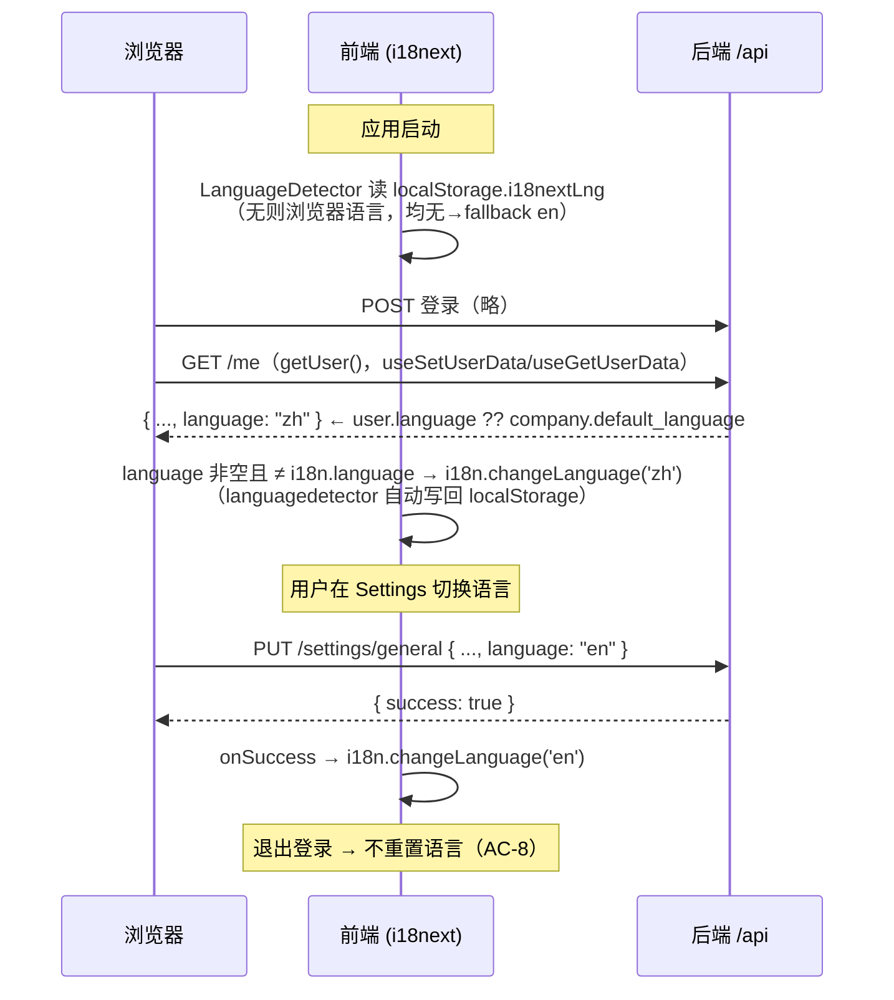

# 多语言设置 — 开发方案

> 模块编号：03-多语言设置（原「简体中文本地化」，2026-07-23 更名；本期交付简体中文资源，架构按多语言设计）· FR 编号：FR-C1~C9 · 需求文档：[需求.md](需求.md)
> 表结构权威版本：[开发方案-表结构设计.md](../开发方案-表结构设计.md) §3.3（本文摘录，逐字一致）
> 代码基线：v20260705（后端 `C:\github-code\chain-serve\v20260705\CSS_backend-main`，前端 `C:\github-code\chain-serve\v20260705\CSS_frontend-main`，alembic head = `3bdd9e1f06c8`）
> 编制日期：2026-07-20

---

## 1. 方案概述

**技术路线**：前端 i18n 框架（i18next + http-backend + languagedetector，`fallbackLng: 'en'`）已全栈就绪，本模块不引入任何新框架。工作量的主体是**四件事**：① 新建 `public/locales/zh/` 15 个 namespace 的全量翻译资源（约 2,089 个叶子 key）；② 打通「选择 → 持久化 → 登录初始化」的语言切换链路（激活死掉的语言选择器、落 `user.language` 到后端、登录后 `i18n.changeLanguage`）；③ 清偿订购全链路的硬编码英文文案（Catalog 为重灾区），全部改为 `t()`；④ 货币/日期/数量格式化随 locale。

**数据与接口**：零新表，仅 2 列 DDL（`user.language` + `company.default_language`，迁移 M4）；产品中文名 `store_product.name_en/name_zh` 已在位，零 DDL。接口层**无新增端点**，全部为对 5 个现有端点的向后兼容改造（新增可空字段），外加启用 `X-Language` 请求头约定。语言解析优先级统一为：**`user.language` > `company.default_language` > 前端 localStorage/浏览器检测 > `'en'`**。

**分期**：按 Q11 建议，首期交付「站内页面全中文」（FR-C1~C7）；邮件/短信模板中文化（FR-C8）放二期，但本期完成 `X-Language` 头打通与 `user.language` 数据落库，使二期只需改模板渲染层。西班牙语（FR-C9，Q10）本期不交付资源，但语言字段用 `varchar(8)` + 应用层 StrEnum、前端 locale 映射表均按多语言可扩展设计。

**风险控制**：所有后端改动为加列/加字段的向后兼容变更，老前端可与新后端共存；前端翻译资源按 namespace 增量合入，配 CI key 一致性检查（en/zh 键集合比对），任何缺 key 自动回退英文而非空白（AC-5）。前端现存 16 个 tsc 类型错误（构建走 `Dockerfile.novalidate`）是全项目已知风险，建议在本模块大量改动 `.tsx` 前先行清障（见《需求分析》§四）。

---

## 2. 表结构设计

### 2.1 语言列（表结构设计文档 §3.3，逐字摘录）

```sql
ALTER TABLE "user"  ADD COLUMN language varchar(8);           -- 'en'/'zh'，NULL=en
ALTER TABLE company ADD COLUMN default_language varchar(8);   -- 实体默认语言，NULL=en
```

对应 Alembic 迁移：**M4 `add_user_language`**（基于 `3bdd9e1f06c8` 的迁移序列 M1~M10 中的第 4 个，见表结构设计文档 §四；两列均可空，无锁风险，downgrade 为 DROP COLUMN）。

逐列设计说明：

| 表.列 | 类型 | 说明 |
|-------|------|------|
| `user.language` | `varchar(8)`，可空 | 用户个人语言偏好。NULL 语义 = 未显式设置，解析时回退 `company.default_language` → `'en'`。**不用 PG enum**（遵循表结构设计文档基线核查结论 #9：状态/字典类字段一律 varchar + 应用层 StrEnum），应用层新增 `LanguageEnum(StrEnum)`：`EN = 'en'`、`ZH = 'zh'`（预留 `ES = 'es'`，Q10 确认后启用）。宽度 8 预留 `zh-Hant` 类带子标签值 |
| `company.default_language` | `varchar(8)`，可空 | 实体（公司）级默认语言，满足需求 §6.2「按实体的默认语言设置」与「为指定的 Ocean Island 用户将中文设为默认语言」：Ocean Island 公司配 `'zh'` 后，其新建/新受邀用户创建时继承该值写入 `user.language`（应用层规则，见 §3.7） |

### 2.2 产品双语品名 —— 无表结构变更

`store_product` 已有 `name_en` / `name_zh` 双列（`core/products/models.py:126-127`，由迁移 `c5e8f1a2b3d4` 从 name/alternative_name 改名而来），后端搜索已含 `name_zh`（ilike + 相关性打分，`core/stores/products/repositories.py:26,140-141`），因此本模块**零 DDL**。

⚠️ **API 读写键不一致（存量现状，本期不改契约）**：

- **读**：产品响应中中文名以序列化别名 `alternative_name` 输出（`core/stores/products/dto.py:54`：`name_zh: str | None = Field(default=None, serialization_alias='alternative_name')`），前端经 humps 驼峰化后读到 `alternativeName`；
- **写**：创建/编辑产品的请求体字段为 `name_zh`（`main_app/vendor/transport/requests.py:96`），前端提交 `nameZh`。

前端 `models/common/api.ts:118-120` 同时声明了 `nameEn?` / `nameZh?` / `alternativeName?` 三键。本方案在前端新建统一取名工具 `getLocalizedProductName()`（见 §4.5）屏蔽该不一致；**是否在后端统一读写键为 `name_zh`**（给 `alternative_name` 保留一个过渡版本的双写别名）——⚠️ 待确认：牵连 Catalog/订单/发票等多个读方，建议列入技术债单独排期，本期不动。

### 2.3 其余相关改动 —— 无表结构变更

UI 翻译资源（静态 JSON 文件）、语言选择器、`X-Language` 头、货币/日期格式化均为纯代码改动，无 DDL。

---

## 3. 接口设计

### 3.1 总表

本模块**无新增端点**，共改造 5 个现有接口 + 1 项请求头约定。路径均挂在 `/api` 网关下（全部受 `X-API-KEY` 守卫），鉴权写法沿用现有 handlers：`Security(check_access_token)` + `Depends(check_permissions(required_permissions=[...]))`。

| # | 方法 | 路径 | 权限 | 类型 | 说明（一句话） |
|---|------|------|------|------|----------------|
| 1 | GET | `/settings/general?type={type}&id={id}` | `check_access_token` | 改造 | 返回当前用户通用设置，`user` 对象新增 `language` 字段，供设置页回显语言偏好 |
| 2 | PUT | `/settings/general?type={type}&id={id}` | `check_access_token` | 改造 | 更新用户资料，请求体新增可选 `language` 字段，实现用户语言偏好写入 |
| 3 | GET | `/me` | `check_access_token` | 改造 | 登录初始化接口新增 `language` 字段（已解析的生效语言），前端据此执行 `i18n.changeLanguage` |
| 4 | GET | `/settings/companies/{company_id}` | `check_access_token` + `check_permissions(required_permissions=['view__company'])` | 改造 | 公司设置响应新增 `default_language`，供公司设置页回显实体默认语言 |
| 5 | PUT | `/settings/companies/{company_id}` | `check_access_token` + `check_permissions(required_permissions=['edit__company'])` | 改造 | 公司设置更新请求体新增可选 `default_language`，实现实体默认语言配置 |
| — | （请求头） | `X-Language: zh` 随所有前端请求发送 | — | 约定 | 前端启用被注释的 `X-Language` 头；后端新增轻量中间件读入 `request.state.language`，本期仅透传记录，二期供邮件/短信/直出 message 本地化使用 |

> 覆盖核对：FR-C3.1（接口 1/2/3）、FR-C3.2（接口 4/5 + §3.7 服务规则）、FR-C8 前置（X-Language 约定）。FR-C1/C2/C4/C5/C6/C7/C9 为纯前端/资源工作，无接口。

### 3.2 改造接口：GET `/settings/general`

- **用途**：设置页（General Settings tab）读取当前用户资料；本期在 `user` 内加 `language`。
- **代码落点**：`internal/main_app/settings/transport/handlers.py`（`general_settings_router`，`handlers.py:95-128`）；响应模型 `GeneralSettingsUserOut`（`transport/responses.py:12-18`）加 `language: str | None`；服务层 `core/settings/services.py` 的 `get_general_settings` 透传用户模型新列。
- **请求参数**（query，现状不变）：`type`（`BusinessEntityType`：`company`/`restaurant`）、`id`（UUID，company 或 restaurant 主体 id）。
- **响应体示例**（200）：

```json
{
  "account_type": "VENDOR",
  "user": {
    "first_name": "John",
    "last_name": "Smith",
    "role_id": "0b9f5a52-6a4e-4a1e-9c0f-1d2e3f4a5b6c",
    "email": "css@gmail.com",
    "phone_number": "+14155550123",
    "security_code": "482913",
    "language": "zh"
  }
}
```

- **字段说明**：`language` 为 `user.language` 原始值（可为 `null`，表示未显式设置——前端回显为「跟随默认」时使用生效语言，见 §4.3）。
- **错误码**：`403 FORBIDDEN`（`type: YOU_HAVE_NO_RIGHTS_TO_WORK_WITH_THIS_RESOURCE`）——沿用现有分支；`401`（token 失效，网关层）。

### 3.3 改造接口：PUT `/settings/general`

- **用途**：保存用户资料表单；本期支持一并写入语言偏好（语言选择器与姓名/邮箱同表单提交，交互沿用现状「改动 → Save」）。
- **代码落点**：请求模型 `GeneralSettingsUserIn`（`transport/requests.py:22-28`）加 `language: LanguageEnum | None = None`；DTO `GeneralSettingsUserUpdateDTO`（`core/settings/dto.py`）同步加字段；服务层 `update_general_settings` 写 `user.language`（`None` 表示不修改，遵循可选字段惯例）。
- **请求参数**（query）：同 GET。
- **请求体示例**：

```json
{
  "first_name": "John",
  "last_name": "Smith",
  "email": "css@gmail.com",
  "phone_number": "+442083661177",
  "language": "zh"
}
```

- **响应体示例**（200）：

```json
{
  "success": true
}
```

- **错误码**：
  - `400 BAD_REQUEST`（`type: CONTACT_ALREADY_USE`，邮箱/手机冲突，现有分支）；
  - `403 FORBIDDEN`（`type: YOU_HAVE_NO_RIGHTS_TO_WORK_WITH_THIS_RESOURCE`）；
  - `422`（pydantic 校验：`language` 不在 `LanguageEnum` 枚举内，如传 `"fr"`）。

### 3.4 改造接口：GET `/me`

- **用途**：登录/刷新后前端初始化用户态的第一跳（`src/api/user.ts` 的 `getUser()`）；本期返回**生效语言**，避免语言初始化多打一次请求。
- **代码落点**：`internal/main_app/me/transport/handlers.py:16-35`；响应模型 `UserMeOut`（`me/transport/responses.py:11-16`）加 `language: str | None`；`me/services.py` 的 `get_user_me` 中按 §3.7 优先级解析（`user.language` 非空直接用；为空则 LEFT JOIN 用户所属 company 取 `default_language`；仍空返回 `null`，前端回退检测器结果）。
- **请求参数**：无。
- **响应体示例**（200）：

```json
{
  "id": "7c2f1a90-3d4b-4c5e-8f6a-9b0c1d2e3f40",
  "phone_number": "+14155550123",
  "email": "css@gmail.com",
  "onboarding_step": null,
  "is_authorized": true,
  "language": "zh"
}
```

- **错误码**：`401`（token 失效）。无新增错误分支。

### 3.5 改造接口：GET `/settings/companies/{company_id}`

- **用途**：公司设置页读取；本期加 `default_language` 回显。
- **代码落点**：`handlers.py:199-235`；响应模型 `CompanySettingsOut`（`transport/responses.py:59-75`）加 `default_language: str | None`；服务层透传 company 新列。
- **响应体示例**（200，节选，仅示意新增字段位置；其余字段现状不变）：

```json
{
  "id": "5e8d7c6b-4a39-4f28-b17e-0d9c8b7a6f5e",
  "name": "Ocean Island Liquor",
  "alternative_name": null,
  "website": "https://oceanisland.example.com",
  "address": "123 Harbor Blvd, Honolulu, HI",
  "email": "ops@oceanisland.example.com",
  "date_founded": "2015-03-01",
  "default_language": "zh",
  "logo": null,
  "work_schedule_sets": [],
  "contact_persons": [],
  "emergency_contact_persons": [],
  "phone_numbers": []
}
```

- **错误码**：`403 FORBIDDEN`（无 `view__company` 权限或非本公司资源）；`422`（company_id 非 UUID）。

### 3.6 改造接口：PUT `/settings/companies/{company_id}`

- **用途**：公司设置更新；本期支持配置实体默认语言（仅持有 `edit__company` 权限的角色，如 CEO/CFO——满足「客户不可自改」：餐厅普通用户无此权限）。
- **代码落点**：`handlers.py:238-298`；请求模型 `CompanySettingsUpdateIn`（`transport/requests.py`）与 DTO `CompanySettingsUpdateDTO` 加 `default_language: LanguageEnum | None = None`。
- **请求体示例**（节选，其余字段现状不变）：

```json
{
  "name": "Ocean Island Liquor",
  "alternative_name": null,
  "website": "https://oceanisland.example.com",
  "address": "123 Harbor Blvd, Honolulu, HI",
  "email": "ops@oceanisland.example.com",
  "date_founded": "2015-03-01",
  "default_language": "zh"
}
```

- **响应**：`200` 返回 `UpdatedCompanySettingsOut`（含 `default_language` 回显）。
- **错误码**：`403 FORBIDDEN`；`409 CONFLICT` / `400 BAD_REQUEST`（现有分支）；`422`（`default_language` 枚举外值）。

### 3.7 服务层规则（无独立接口）

| 规则 | 落点 |
|------|------|
| **语言解析优先级**：`user.language` → `company.default_language` → `'en'`。提供单一工具函数 `resolve_user_language(user_id) -> str`，供 `/me`、二期通知渲染共用 | 新增 `core/users/services.py` 方法或 `pkg/` 工具 |
| **新用户继承**：注册 onboarding 建号、团队邀请建号两条链路创建 `User` 行时，`language` 初始化为所属 `company.default_language`（为空则留 NULL） | `core/auth` / `core/users` 的创建服务 + `onboardings/services.py` |
| **X-Language 中间件**：读取请求头 `X-Language`（合法值 `en`/`zh`，非法/缺失回退 token 用户的 resolve 结果），写 `request.state.language`。本期仅落 request 态与日志，不改变任何响应内容 | 新增 `internal/main_app/middlewares/language/`（仿 `middlewares/jwt`、`middlewares/permissions` 的目录范式） |

---

## 4. 前端设计

### 4.1 页面与路由

本模块**不新增路由**。语言选择器位于既有 Settings 页的 General Settings 区块内（路由写法与 `src/constants/paths.ts` 的 `Paths` 枚举现状一致）：

| 路由路径（Paths 常量） | 页面组件 | 权限守卫 | 说明 |
|------------------------|----------|----------|------|
| `Paths.SETTINGS = '/settings'` | `ui/pages/Settings`（`app/constants/routes.tsx` 中经 `PrivateRoute` 包裹的现有 Route） | `PrivateRoute`（登录态）；General Settings 区块所有登录用户可见 | 激活其中 `LanguageContent` 语言选择器（FR-C2）；公司设置区块（`default_language`）沿用页内已有的公司设置表单与其权限控制 |
| （全站） | 所有页面 | 不变 | 翻译资源与格式化改造不触碰路由结构 |

### 4.2 文件清单

**新建：**

| 路径 | 内容 |
|------|------|
| `public/locales/zh/common.json` 等 **15 个文件**（catalog/chats/clients/common/dashboard/delivery/forms/invoices/logs/onboarding/orders/products/settings/team/vendors） | zh 翻译资源，键结构与 `public/locales/en/` 完全一致（FR-C1） |
| `src/constants/locales.ts` | 语言常量：`SupportedLanguages = { EN: 'en', ZH: 'zh' }`、语言选项数组（含中文自名「简体中文」）、`LOCALE_MAP = { en: 'en-US', zh: 'zh-CN' }`（供 Intl/date-fns 使用） |
| `src/utils/productName.ts` | `getLocalizedProductName(product, lang)`：zh 界面优先 `nameZh ?? alternativeName`，回退 `nameEn ?? name`；en 界面反之（屏蔽 §2.2 读写键不一致；Q11） |
| `scripts/check-locales.(mjs)` + CI 步骤 | en/zh 键集合一致性检查（AC-9） |

**修改：**

| 路径 | 改动 |
|------|------|
| `src/config/i18n/i18n.ts` | `supportedLngs: ['en', 'zh']`；（可选）`ns` 预载列表补齐常用 namespace 或维持按需加载现状 |
| `src/ui/pages/Settings/ui/GeneralSettings/useGeneralSettings.tsx` | `languages` 数组改为取自 `constants/locales.ts` 的双语选项（value 用 `'en'`/`'zh'`，替换现值 `'english'`）；`reset` 回显 `generalSettingsData.user.language`；`prepareData` 增加 `language`；mutation `onSuccess` 中 `i18n.changeLanguage(savedLanguage)` |
| `src/ui/pages/Settings/ui/GeneralSettings/ui/LanguageContent/LanguageContent.tsx` | `onSelectValue` 接回 react-hook-form `field.onChange`（替换空实现 `() => {}`） |
| `src/ui/pages/Settings/ui/GeneralSettings/types.ts` | `GeneralSettingsFields` 增加 `language` |
| `src/models/settings/api.ts` | `GetGeneralSettingsResponse.user` 与 `UpdateGeneralSettingsRequest` 增加 `language`；公司设置类型增加 `defaultLanguage` |
| `src/models/user/api.ts` | `UserResponse` 增加 `language` |
| `src/hooks/auth/useSetUserData.ts`、`src/hooks/auth/useGetUserData.ts` | 取到 `/me` 后：`if (user.language && user.language !== i18n.language) i18n.changeLanguage(user.language)`（登录初始化时序，见 §4.3） |
| `src/config/axios/http.ts`、`src/config/axios/privateHttp.ts` | 启用被注释的 `X-Language` 头（`http.ts:22-28` 的 TODO）：`'X-Language': i18n.language?.split('-')[0] ?? 'en'` |
| `src/utils/formatCurrency.ts`、`src/constants/intlFormats.ts`、`src/constants/variables.ts` | locale 由 `DEFAULT_ARIA_LOCALE` 常量改为 `LOCALE_MAP[i18n.language]` 动态获取；`currency: 'USD'` **保持不变**（计价货币不随语言变，仅展示格式本地化） |
| `src/utils/datetime.ts` | `formatDateTime` 按语言选择格式模板（en：`MM/dd/yyyy` + `h:mm a`；zh：`yyyy/MM/dd` + `HH:mm`），date-fns `format` 第三参传 `{ locale }`（`date-fns/locale` 的 `zhCN`） |
| `src/models/errors.ts` + `src/ui/features/OrderForm/ui/MultistepOrderForm/useMultistepOrderForm.tsx:281-292` | FR-C7：`onError` 不再直出 `errorData.message`，改为 `errorData.type` → `errorMessages` 翻译 key 映射，未知 type 回退 `errorMessages.unknown` |
| 订购链路硬编码组件（逐屏清单见 §4.4） | 硬编码英文 → `t()`（FR-C4） |

### 4.3 语言初始化时序（FR-C2/C3 链路）



要点：`i18n.changeLanguage` 是全站唯一切换入口（当前全库零调用，G3）；服务端值优先于本地缓存（同一账号换设备语言一致，AC-2）；未登录页（登录/注册）按检测器结果展示，登录后以 `/me` 为准校正。

### 4.4 硬编码文案改造范围（FR-C4，按订购流程逐屏）

对照译文 §6.3 的 17 项翻译范围，逐屏列出改造对象（「t() 现状」为本次代码抽查结论）：

| # | 订购流程屏 | 页面/组件（真实路径，均在 `src/ui/` 下） | namespace | t() 现状与改造点 |
|---|-----------|------------------------------------------|-----------|------------------|
| 1 | 登录与认证 | `pages/Auth`、`pages/Registration`、`pages/PasswordReset` | forms/common | 覆盖较好，抽查补漏 |
| 2 | 导航菜单 | `app/ui/PrivateRoute` 布局 + Sidebar（`PathsNames` → `common:pathnames.*`） | common | key 已就绪，仅需 zh 资源 |
| 3 | 产品分类/目录页 | `pages/Catalog/Catalog.tsx`、`pages/Catalog/ui/ProductList/ProductList.tsx`、`pages/Catalog/useCatalog.tsx` | catalog | **无 i18n 引用**，整体接入 |
| 4 | 产品卡片（目录重灾区） | `pages/Catalog/ui/ProductCard/ProductCard.tsx` | catalog/common | 硬编码 `Unit:`/`Weight Unit:`/`In Stock:`/`Min Qty:`/`Category:`/`Price`/`Tax:`/`Published`/`Unpublished`（`ProductCard.tsx:46-83`）全部改 t()；品名改用 `getLocalizedProductName` |
| 5 | 搜索与筛选 | `pages/Catalog/ui/ProductFiltersBar/ProductFiltersBar.tsx`、`pages/Catalog/ui/CopyAndPaseForm/CopyAndPasteForm.tsx`、`pages/GlobalSearch` | catalog/common | 抽查发现硬编码，逐个改造 |
| 6 | 产品详情 | `pages/Product`、`widgets/CreateProductForm`（供应商侧） | products | 覆盖较好（如 `products:createProduct.*`），补漏 + 品名双语 |
| 7 | 下单向导（选供应商/客户信息/加购/订单明细） | `features/OrderForm/ui/MultistepOrderForm/ui/{SelectVendorStep,ClientInfoStep,AddProductsStep,OrderDetailsStep}` | orders/forms | 主链路覆盖较好，逐屏抽查补漏 |
| 8 | 购物车/订单核对（下单前） | `features/OrderForm/ui/MultistepOrderForm/ui/CheckOrderStep`（含 `EditOrderInfoModal`） | orders | toast 已 key 化（`orders:toast.*`），补漏 |
| 9 | 订单提交与失败提示 | `features/OrderForm/ui/MultistepOrderForm/useMultistepOrderForm.tsx` | orders + models/errors | FR-C7：`onError:281-292` 直出后端英文 message，改 type→key |
| 10 | 订单提交成功确认 | `pages/NewOrder` 完成态 / 跳转 `pages/Order` | orders | 抽查补漏 |
| 11 | 订单历史与状态 | `pages/Orders`、`pages/Order`、`pages/DuplicateOrder` | orders | 覆盖较好；订单状态枚举展示名集中 key 化 |
| 12 | 通知 | `stores/notificationsStore.ts` 消费的通知 UI、`api/notification.ts` 相关组件 | common/dashboard | 通知正文本期后端英文直出（二期 FR-C8），通知面板骨架文案本期中文化 |
| 13 | 校验提示 | react-hook-form 各表单 rules message（forms namespace） | forms | key 化良好，zh 资源补齐 |
| 14 | 错误信息 | `src/models/errors.ts`（`errorMessages` type→key 映射表） | common/forms | 补齐后端错误 type 枚举映射（FR-C7） |
| 15 | 执照状态与到期提示 | 执照合规模块新页面（跨模块，文案 key 由本模块 namespace 承载） | 新增 key（建议归入 orders/common 或新 namespace `licenses`） | 待执照模块文案定稿后补翻（P0，联动排期） |
| 16 | 价格与单位标签 | `utils/formatCurrency.ts`、`stores/unitStore.ts` 及单位展示组件 | common/products | FR-C5 + 单位标签 key 化 |
| 17 | 通用动作/空态/弹窗 | `ui/shared/*`（Button/Modal/Table 空态等） | common | 覆盖较好，抽查补漏 |

改造纪律：新增 key 一律进对应领域 namespace；禁止组件内拼接句子（用 i18next interpolation/plural）；PR 审查时以「diff 中不得出现面向用户的裸英文字符串字面量」为门禁。

### 4.5 关键组件与交互

- **语言选择器**（`LanguageContent`）：受控 Select，选项「English / 简体中文」；变更后表单进入 dirty 态，随 General Settings 的 Save 一并提交（沿用 `useNavigateBlocker` 未保存拦截交互）；保存成功即时 `changeLanguage`，无需刷新（AC-1）。
- **公司默认语言**：在 Settings 公司设置表单（`putCompanySettings`，`src/api/settings.ts:76-80`）增加「Default language」下拉，仅对持有 `edit__company` 权限的角色可编辑（后端强校验，前端按现有 abac 规则隐藏）。
- **双语品名**：所有展示产品名处统一改经 `getLocalizedProductName`；产品编辑表单沿用现有 `nameEn`/`nameZh` 双输入（`widgets/CreateProductForm` 已有 ZH Name 能力，抽查确认字段绑定）；导入模板含 `name_en`/`name_zh` 两列（Q11，价格等级模块的导入管道复用此约定）。

### 4.6 状态管理与翻译资源工作量

**状态管理**：语言的运行时单一权威 = `i18n.language`（i18next 实例 + languagedetector 的 localStorage 持久化）；服务端持久化 = `user.language`。**不新增 Zustand store**（`userStore` 不冗余存语言，避免双源）。TanStack Query：复用现有 `QueryKeys.GET_GENERAL_SETTINGS`（`useGeneralSettings.tsx:41`）；`/me` 查询在语言保存成功后无需强制失效（语言已本地生效，下次自然刷新）；语言切换后**无需**失效业务数据查询（响应数据语言无关，UI 文案由 i18next 重渲染）。

**翻译工作量（按 namespace 拆解，key 数为 `public/locales/en/` 实测叶子键数，共 2,089）：**

| namespace | key 数 | 订购链路相关度 | 批次 |
|-----------|--------|----------------|------|
| orders.json | 340 | 高（屏 7-11） | 第 1 批 |
| forms.json | 278 | 高（登录/校验，屏 1/13） | 第 1 批 |
| common.json | 197 | 高（动作/导航/错误，屏 2/14/17） | 第 1 批 |
| products.json | 272 | 高（产品详情，屏 6） | 第 1 批 |
| catalog.json | 32 | 高（屏 3-5；注意该 ns 现有 key 少是因为硬编码未提 key，FR-C4 改造后将显著增长） | 第 1 批 |
| settings.json | 205 | 中（语言选择器所在页） | 第 2 批 |
| clients.json | 232 | 中（供应商侧） | 第 2 批 |
| vendors.json | 117 | 中 | 第 2 批 |
| invoices.json | 69 | 中 | 第 2 批 |
| delivery.json | 103 | 中 | 第 2 批 |
| onboarding.json | 112 | 低（注册向导） | 第 3 批 |
| dashboard.json | 27 | 低 | 第 3 批 |
| team.json | 64 | 低 | 第 3 批 |
| chats.json | 36 | 低 | 第 3 批 |
| logs.json | 5 | 低 | 第 3 批 |

第 1 批（约 1,119 key + FR-C4 新增 key）覆盖译文 §6.3 全部订购流程验收范围，优先交付并送母语审校（需求 §14 依赖）。

---

## 5. 任务拆解

依赖顺序：BE-1 → BE-2/BE-3 → FE-2（联调）；FE-1 与 BE 并行；FE-4~FE-6 依赖 FE-1；TR 系列贯穿。

### 后端（合计约 4.5 人日）

| ID | 任务 | 依赖 | 预估 |
|----|------|------|------|
| BE-1 | 迁移 M4 `add_user_language`（2 列）+ `User`/`Company` models、domains、DTO 同步 + `LanguageEnum` | 迁移序列 M1~M3 已排（可独立先行） | 0.5 |
| BE-2 | `/settings/general` GET/PUT 与 `/me` 增加 language（requests/responses/DTO/service/repo 五层）+ `resolve_user_language` 工具 | BE-1 | 1.5 |
| BE-3 | 公司设置 GET/PUT 增加 `default_language` + 新用户创建继承规则（onboarding/团队邀请两链路） | BE-1 | 1.5 |
| BE-4 | `X-Language` 中间件（读头→`request.state.language`，非法值回退）+ 接入日志 | 无 | 0.5 |
| BE-5 | 后端集成测试（见 §6.2） | BE-2/3/4 | 0.5 |

### 前端（合计约 12 人日，不含翻译人力与母语审校）

| ID | 任务 | 依赖 | 预估 |
|----|------|------|------|
| FE-1 | i18n 基建：`supportedLngs` 加 zh、`constants/locales.ts`、CI key 一致性脚本、`X-Language` 头启用 | 无 | 1 |
| FE-2 | 语言选择器激活 + General Settings 表单接 language + 登录初始化时序（`useSetUserData`/`useGetUserData`）+ 公司默认语言表单项 | FE-1、BE-2/3 | 2 |
| FE-3 | 格式化本地化：`formatCurrency`/`datetime`/`intlFormats`/`variables` + 全站回归排查调用点 | FE-1 | 1.5 |
| FE-4 | 硬编码改造第一波：Catalog 全目录（屏 3-5，含 `getLocalizedProductName` 工具与品名替换） | FE-1 | 2.5 |
| FE-5 | 硬编码改造第二波：订购向导/提交/历史补漏（屏 7-11）+ FR-C7 错误 type→key（`useMultistepOrderForm.onError` + `models/errors.ts`） | FE-1 | 2.5 |
| FE-6 | 硬编码改造第三波：登录/校验/通知面板/通用组件补漏（屏 1/12/13/17） | FE-1 | 1.5 |
| FE-7 | zh 资源接入联调 + 伪本地化全站走查（长文本溢出、断行） | 翻译第 1 批到位 | 1 |

### 翻译与横切

| ID | 任务 | 依赖 | 预估 |
|----|------|------|------|
| TR-1 | 第 1 批 5 个 namespace 翻译（约 1,119 key + FR-C4 新 key） | FE-4/5 提出新 key 后冻结 | 3（翻译人力） |
| TR-2 | 第 2/3 批 10 个 namespace 翻译（约 970 key） | TR-1 后 | 2.5（翻译人力） |
| TR-3 | 母语审校（需求 §14 依赖，外部资源） | TR-1/2 | 外部排期 |
| TR-4 | 执照/合规文案 key 补翻（跨模块） | 执照模块文案定稿 | 0.5 |

---

## 6. 测试要点

### 6.1 单元测试

- `formatCurrency`：en 下 `1234.5 → $1,234.50`；zh 下 `1234.5 → US$1,234.50`（locale=zh-CN、currency 仍 USD）；`NaN/null/undefined → '0.00'`（现有行为不回归）。
- `datetime.formatDateTime`：同一 ISO 串在 en/zh 下分别产出 `MM/dd/yyyy`+`h:mm a` 与 `yyyy/MM/dd`+`HH:mm`；非法输入行为不回归。
- `getLocalizedProductName`：四象限（zh 界面×有/无 nameZh；en 界面×有/无 nameEn）+ 仅有 `alternativeName` 键的旧数据兼容。
- 后端 `resolve_user_language`：user.language 命中 / 回退 company.default_language / 双空回退 `'en'` 三分支。
- 后端 `LanguageEnum` 校验：`GeneralSettingsUserIn(language='fr')` 触发 pydantic 422。
- CI key 一致性脚本自身：构造缺 key/多 key 的 fixture 断言报告正确。

### 6.2 集成测试（后端，pytest，仿 `main_app/settings/tests` 现有范式）

- GET/PUT `/settings/general`：写入 `language='zh'` 后 GET 回读一致；`language` 缺省时 PUT 不改变既有值；写非法值 422。
- GET `/me`：user.language 为空且 company.default_language='zh' 时返回 `'zh'`；两者皆空返回 `null`。
- PUT `/settings/companies/{company_id}`：无 `edit__company` 权限的角色写 `default_language` 得 403（权限用例）；越权访问他公司 403。
- 新用户创建继承：company.default_language='zh' 下走邀请链路建号，断言新 `user.language='zh'`。
- `X-Language` 中间件：头为 `zh`/缺失/非法值三态下 `request.state.language` 取值正确；不影响任何现有响应体（回归）。

### 6.3 E2E（Playwright，关键用户流）

- **中文完整下单流**（对应 AC-3）：切换中文 → 登录 → 目录 → 搜索 → 详情 → 加购 → 核对 → 提交 → 订单历史，逐屏断言无英文界面文案（白名单排除业务数据字段）。
- **语言持久化**：切中文 → 关闭浏览器上下文重开 → 仍中文；同账号新上下文（无 localStorage）登录 → `/me` 驱动为中文（AC-1/AC-2）。
- **回退**：删除 zh `catalog.json` 单个 key 构造缺失 → 对应位置显示英文原文、无空白/key 名泄漏（AC-5）。
- **切回英文回归**：全流程英文无残留中文（AC-4）。
- **登出语言保持**：中文态登出 → 登录页仍中文（AC-8）。

### 6.4 边界与专项

- 中文文本较英文短/长导致的布局：按 web 测试规则跑 320/768/1024/1440 视觉回归，重点 Sidebar、按钮、表格表头。
- zh 搜索链路：中文关键词搜索命中 `name_zh`（后端已支持，做端到端确认）。
- 双语品名读写键不一致回归：产品编辑保存 `nameZh` 后目录页（读 `alternativeName`）显示正确。
- 权限边界：餐厅普通用户不可见/不可改公司 `default_language`；任何用户只能改自己的 `user.language`（PUT `/settings/general` 以 token 内 user_id 为准，不受 query id 影响——集成测试覆盖）。
- FR-C7 回归：模拟订单创建 4xx（带 type）断言展示映射后的本地化文案而非后端英文 message。

---

## 附：与基准文档的一致性说明

- 本文 §2.1 DDL 与《开发方案-表结构设计.md》§3.3 逐字一致；迁移编号沿用其 §四 的 M4。
- FR 编号、优先级、现状标注与《需求分析与功能需求列表》§五 C 组一致；其中「41% 组件未接入 t()」与「后端邮件/短信英文硬编码」两点引自该文档（后者本次未逐一复核，标注见需求文档 G13）。
- 开放问题引用以《开放问题确认单》编号为准（Q10/Q11）。
