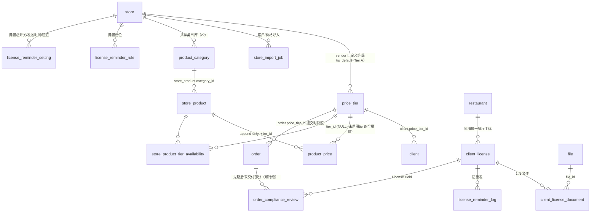

# Ocean Island 开发方案 —— 表结构修改设计（v2）

> 基线：**v20260705 代码**（alembic head = `3bdd9e1f06c8`）+ **preprod 数据库**（`alembic_version = 3bdd9e1f06c8`，两者同版）。所有新迁移基于 `3bdd9e1f06c8` 续写。
> **v2（2026-07-27）依正式修订版需求 PDF 重排，替换 2026-07-16 草稿口径。** 关联：[中文译文](Ocean-Island-酒类供应商系统增强需求-中文版.md) · [需求分析 v2](需求分析与功能需求列表.md) · [功能列表](功能列表.md) · [开放问题确认单 v2](开放问题确认单.md)。

---

## 〇、v2 相较 v1 的表结构变化（先读）

| # | 变化 | 表结构影响 |
|---|------|-----------|
| 1 | **Tier A = 默认与回退价**（§6.2，推翻"绝不回退"） | `price_tier` 的 `is_default` 行即 Tier A；取价缺所在等级价时回退 Tier A；三态可购性判定规则重写（见 §3.4.3） |
| 2 | **交付前动态调价**（§8.2，推翻"提交即锁价"） | 新增 `order.price_tier_id`（提交时快照客户等级，供未达 Delivered 时按随单等级重算）；重算引擎为应用层，无独立表 |
| 3 | **新增产品类目管理**（§3.3） | 新增 `product_category` 表 + `store_product.category_id`（见 §3.7） |
| 4 | 执照**两套独立状态**（§9.2） | `client_license` 的单一 `status` 拆为 `verification_status` + `expiration_status` 两列 |
| 5 | **管理员 override 出局**（§2.2） | **删除** `license_restriction_override` 表；`api_entity` 去掉 `compliance_override`；`orderevent` 去掉 `COMPLIANCE_OVERRIDDEN` |
| 6 | 合规仪表盘/报表导出出局（§2.2） | 无表结构影响（本就是聚合查询 + 导出，删相关端点即可） |
| 7 | 定价审计**界面**出局、tier/价格变更**通知**出局（§2.2/§10.1） | `product_price.changed_by_user_id` 仍保留（改价可追溯），但不做审计查询界面；`notification_event_preference.event_type` 收敛为仅执照类 |
| 8 | License Hold = 合规标记、按行处理部分交付（§9.7） | `order_compliance_review` 增 `order_product_id`（可空，NULL=整单 Hold，非空=行级 Hold） |
| 9 | 提醒按 vendor 时区（§9.5） | 新增 `company.timezone` + `license_reminder_setting`（store 级发送时间/通道/是否到期日发） |

**净变化**：新表 11 张（删 override、加 product_category + license_reminder_setting，故较 v1 +1）；修改表增加 `order`/`store_product`/`company`。

---

## 一、基线核查结论（v20260705，仍有效）

| # | 发现 | 对设计的影响 |
|---|------|--------------|
| 1 | `payment_method` = "系统预置 + 自定义"字典表范式（name unique / is_system / created_by），domain 在 `core/payment_methods/` | **price_tier 与 product_category 均照抄此范式** |
| 2 | `vendor_product` 的 `cost/sell_price/markup/margin` 是报价 epic 预留字段，无写入路径，不参与取价 | 价格等级建在 StoreProduct/ProductPrice 侧 |
| 3 | `store_product` 已有 `name_en`/`name_zh` 双语品名（搜索已支持） | 产品中文名零 DDL；API 读键 `alternativeName`、写键 `name_zh` |
| 4 | `CompanyAuditLog` 已扩展（entity_type/action + per-field 审计写入与测试） | 审计不建新表，扩展枚举 |
| 5 | 会话单会话被强化（JWT sid 与 Redis 逐请求比对，新登录踢旧设备；改密不吊销；无管理员踢出） | 多设备 30 天登录需新表 `user_session` |
| 6 | `BusinessType` 已含 MANUFACTURER；多 company_type 层级体系完备；company_type 种子 6 行 | 加 LIQUOR_VENDOR = 纯种子迁移，无需改枚举 |
| 7 | 订单链路插入点 `OrdersService.create_order` / `confirm_vendor_order`；S3 public-read；`_build_calc_input` 是发票/月结/报表共同上游 | 动态调价重算须改 `_build_calc_input` 取价源并带全链路回归 |
| 8 | 导入两代范式：`manufacturer_catalog_import_job` **prepare→commit 两阶段**（幂等、防重复） | 客户/价格导入仿此建 `store_import_job` |
| 9 | `orderevent`/`orderstatus` 为 PG enum；新增状态类字段一律 varchar + 应用层 StrEnum，仅 `orderevent` 加值动 PG enum | 见各表 |

⚠️ 环境注意：旧 `css_dev`（GitHub main + db_compare 补丁）已作废；开发库从 preprod dump 恢复或空库 `alembic upgrade head`（v20260705）重建。

---

## 二、表结构修改总览

**新增 11 张表、修改 8 张表、新增 0 个 PG 枚举**（状态字段全部 varchar + StrEnum，仅 `orderevent` 追加值）：

| 模块 | 新增表 | 修改表 |
|------|--------|--------|
| 实体权限 | —（纯种子） | company_type/api_entity/role/company_role_permission 插行 |
| 会话 | `user_session` | `issued_token` +1 列；`company` +`session_ttl_seconds` |
| 语言 | — | `user` +`language`；`company` +`default_language` |
| 价格等级 + 动态调价 | `price_tier`、`store_product_tier_availability`、`store_import_job` | `client` +`price_tier_id`；`product_price` +3 列；**`order` +`price_tier_id`（动态调价随单等级）** |
| 产品类目（🆕 v2） | `product_category` | `store_product` +`category_id` |
| 执照合规 | `client_license`、`client_license_document`、`license_reminder_rule`、`license_reminder_log`、`license_reminder_setting`、`order_compliance_review` | `company_audit_log`（details→text +索引）；**`company` +`timezone`**；~~`license_restriction_override`~~（**v2 删除**） |
| 通知 | `notification_event_preference` | — |

新表关系（酒类核心域，v2）：



---

## 三、逐模块 DDL 设计

### 3.1 实体与权限（FR-A1~A5）—— 纯种子迁移，无 DDL

```sql
-- 迁移 M1：seed_liquor_vendor_company_type
INSERT INTO company_type (id, name, category, created_at, updated_at)
VALUES ('<固定UUID>', 'Liquor Vendor', 'VENDOR', now(), now());
-- 仿 seed_company_hierarchy 补 company_category + company_type_category 关联

-- 迁移 M2：seed_liquor_api_entities（v2：去掉 compliance_override，加 product_category）
INSERT INTO api_entity (id, name) VALUES
  ('<UUID>', 'price_tier'), ('<UUID>', 'product_category'),
  ('<UUID>', 'customer_license'), ('<UUID>', 'license_review');
-- permission 表已有全局 4 行动作（create/view/edit/delete），无需插行；
-- "权限×实体"由 company_role_permission 三元组表达；新公司经 onboarding 自动获权限矩阵。
--   price_tier / product_category / customer_license：授予 CEO/CFO/Manager
--   license_review：仅 CEO/CFO（+ Compliance Manager，见下）
-- ⚠️ v2 已取消管理员 override，不再种 compliance_override 实体。

-- 迁移 M2（续，视 Q7）：seed_compliance_manager_role
INSERT INTO role (id, type, belongs_to_company, name)
VALUES ('<固定UUID>', 'VENDOR', true, 'Compliance Manager');
-- ⚠️ 此 UUID 须同步硬编码到前端 constants/roles.ts 的 UserRole
```

要点：不改 `CompanyTypeEnum`/`BusinessType`/PG 枚举；敏感端点用 `check_permissions(required_roles=[RoleName.CEO, RoleName.CFO, ...])`；勿引用已删的 Chef 角色（迁移 `a3f1c9d27b84`）。前端配套：`CompanyTypes.LIQUOR_VENDOR`、`NAME_TO_COMPANY_TYPE['Liquor Vendor']`、businessCards 第 7 张卡、i18n 文案。

### 3.2 持久会话（FR-C1~C7）

**新表 `user_session`**（把"Redis 单值会话"升级为"DB 权威 + Redis 缓存"多设备会话，JWT `sid` 即主键）：

```sql
CREATE TABLE user_session (
    id              uuid PRIMARY KEY,                -- = JWT sid
    user_id         uuid NOT NULL REFERENCES "user"(id) ON DELETE CASCADE,
    device_id       varchar(36)  NOT NULL,
    device_name     varchar(255),
    ip_address      varchar(45),
    user_agent      varchar(512),
    expires_at      timestamptz  NOT NULL,           -- 登录时间 + 会话策略 TTL
    last_active_at  timestamptz  NOT NULL DEFAULT now(),
    revoked_at      timestamptz,                     -- NULL=活跃
    revoked_by_user_id uuid REFERENCES "user"(id) ON DELETE SET NULL,
    revoke_reason   varchar(50),                     -- LOGOUT/PASSWORD_CHANGE/ADMIN_KICK/EXPIRED
    created_at      timestamptz  NOT NULL DEFAULT now(),
    updated_at      timestamptz  NOT NULL,
    deleted_at      timestamptz
);
CREATE INDEX ix_user_session_user_id ON user_session(user_id) WHERE revoked_at IS NULL;
CREATE INDEX ix_user_session_expires_at ON user_session(expires_at);
```

```sql
ALTER TABLE issued_token ADD COLUMN session_id uuid
    REFERENCES user_session(id) ON DELETE SET NULL;   -- 存量 NULL，新签发必填
CREATE INDEX ix_issued_token_session_id ON issued_token(session_id) WHERE NOT revoked;

ALTER TABLE company ADD COLUMN session_ttl_seconds integer;  -- Ocean Island 配 2592000（30 天），NULL=全局默认
```

配套代码（无 DDL）：Redis 键改 per-sid；`verify_access_token` 校验"该 sid 是否活跃"；`change_password`/`reset_password` 补"吊销该用户全部 session+token"；新增 admin 踢出端点；`access_token_ttl` 8h→15min（env）。**v2 无变化，模块 02 设计沿用。**

### 3.3 语言（FR-D3）—— 2 列

```sql
ALTER TABLE "user"  ADD COLUMN language varchar(8);           -- 'en'/'zh'，NULL=en
ALTER TABLE company ADD COLUMN default_language varchar(8);   -- 实体默认语言，NULL=en
```

产品中文名零 DDL（`store_product.name_en/name_zh` 已在位）。类目双语名见 §3.7。

### 3.4 价格等级 + 动态调价（FR-E1~E8、F1~F6）⚠️ v2 模型反转

#### 3.4.1 新表 `price_tier`（照抄 payment_method 范式 + store 维度）

```sql
CREATE TABLE price_tier (
    id                 uuid PRIMARY KEY,
    store_id           uuid NOT NULL REFERENCES store(id) ON DELETE CASCADE,
    name               varchar(100) NOT NULL,
    description        varchar(500),
    is_active          boolean NOT NULL DEFAULT true,
    is_default         boolean NOT NULL DEFAULT false,   -- ⭐ v2: is_default 的等级即 "Tier A"（默认与回退等级）
    sort_order         integer NOT NULL DEFAULT 0,
    archived_at        timestamptz,
    created_by_user_id uuid REFERENCES "user"(id) ON DELETE SET NULL,
    created_at         timestamptz NOT NULL DEFAULT now(),
    updated_at         timestamptz NOT NULL,
    deleted_at         timestamptz
);
CREATE UNIQUE INDEX uq_price_tier_store_name ON price_tier(store_id, name) WHERE deleted_at IS NULL;
CREATE UNIQUE INDEX uq_price_tier_store_default ON price_tier(store_id) WHERE is_default AND deleted_at IS NULL;
```

> 等级集合是 **store（vendor）级统一维度**；数量/命名自由（§6.1）。**v2 关键**：每个 store 必须有且仅有一个 `is_default=true` 的等级——它承担 §6.2 的 **Tier A（默认与回退）**角色。新建/导入客户缺等级时落入该默认等级（§6.1）。

#### 3.4.2 修改 `product_price` —— 加 tier 维度

```sql
ALTER TABLE product_price
    ADD COLUMN tier_id            uuid REFERENCES price_tier(id) ON DELETE RESTRICT,
                                       -- 指向具体等级；NULL = 未启用 tier 的 vendor 的全局价（向后兼容，存量全为 NULL）
    ADD COLUMN changed_by_user_id uuid REFERENCES "user"(id) ON DELETE SET NULL,
    ADD COLUMN import_job_id      uuid;                  -- 关联 store_import_job，手工改价为 NULL
CREATE INDEX ix_product_price_product_tier_created ON product_price(product_id, tier_id, created_at DESC);
```

**必须同步的代码点**：`StoreProduct.price` 的 column_property（`products/models.py`）当前取"最新一条"，加 tier 后必须补 `tier_id IS NULL` 过滤，否则非 tier vendor 的全局价会错取 tier 价——唯一"不改会静默出错"点，评审必查。某等级当前价 = 按 `(product_id, tier_id)` 取 `created_at` 最新一行。

> **v2 取价语义**：对 liquor vendor，`tier_id=NULL` 的行**不参与客户取价**（客户取价一律走 tier + Tier A 回退，见 §3.4.3）；`tier_id=NULL` 仅服务于未启用 tier 的普通 vendor。**每个活跃产品必须有指向该 store 默认等级（Tier A）的价格行**（发布校验，§6.2 规则 4）。

#### 3.4.3 新表 `store_product_tier_availability`（可购性）+ ⭐ Tier A 回退取价规则

```sql
CREATE TABLE store_product_tier_availability (
    id                 uuid PRIMARY KEY,
    store_product_id   bigint NOT NULL REFERENCES store_product(id) ON DELETE CASCADE,
    tier_id            uuid   NOT NULL REFERENCES price_tier(id)    ON DELETE CASCADE,
    availability       varchar(16) NOT NULL DEFAULT 'AVAILABLE',    -- AVAILABLE / UNAVAILABLE
    updated_by_user_id uuid REFERENCES "user"(id) ON DELETE SET NULL,
    created_at         timestamptz NOT NULL DEFAULT now(),
    updated_at         timestamptz NOT NULL,
    deleted_at         timestamptz,
    CONSTRAINT uq_sptavail UNIQUE (store_product_id, tier_id)
);
```

**取价与可购性判定（应用层，§6.2 四条规则 + 判定表）**——⚠️ **v2 反转 v1**：

| 客户等级(=client.price_tier_id) | 该 (产品×客户等级) 价 | Tier A(默认等级) 价 | 客户看到 |
|---|---|---|---|
| 任意 | 该等级标记 `UNAVAILABLE` | — | **不可下单**（规则 1） |
| 例：Tier C | 已配置 | 已配置 | 用 **Tier C 价**（规则 2） |
| 例：Tier C | 缺失 | 已配置 | **回退用 Tier A 价**（规则 3，⭐ v2 新语义） |
| 任意 | 缺失 | 缺失 | **产品不能发布/下单**（规则 4） |

> v1 的"缺价显示'联系供应商'、绝不回退"已作废。v2 一律回退 Tier A，无 Tier A 则产品根本不能上架。客户仍只见适用于自己等级的最终价，看不到等级名或他等级价（§6.3）。

#### 3.4.4 修改 `client` —— 等级分配

```sql
ALTER TABLE client ADD COLUMN price_tier_id uuid REFERENCES price_tier(id) ON DELETE RESTRICT;  -- RESTRICT 兜底"已分配等级不可删"
CREATE INDEX ix_client_price_tier_id ON client(price_tier_id);
```

应用层：新建/导入客户未指定 tier → 落入该 store 的 `is_default`（Tier A）等级（§6.1）；每个活跃客户必须有等级（服务层校验 + M6 存量回填）。**客户不可见/不可改自己等级**（§6.1/§6.3）。tier 分配变更写审计（`company_audit_log`，entity_type=`CLIENT_TIER`，§10.2 必留）。

#### 3.4.5 新表 `store_import_job`（客户/价格导入，FR-E7）

```sql
CREATE TABLE store_import_job (
    id                   uuid PRIMARY KEY,
    store_id             uuid NOT NULL REFERENCES store(id) ON DELETE CASCADE,
    kind                 varchar(20) NOT NULL,     -- CLIENT / TIER_PRICE
    source               varchar(16) NOT NULL DEFAULT 'FILE',
    file_id              uuid REFERENCES file(id) ON DELETE SET NULL,
    status               varchar(20) NOT NULL DEFAULT 'CREATED',   -- CREATED/PARSED/VALIDATED/COMMITTING/COMPLETED/FAILED
    column_mapping       json,
    total_rows           integer NOT NULL DEFAULT 0,
    imported_rows        integer NOT NULL DEFAULT 0,
    skipped_rows         integer NOT NULL DEFAULT 0,
    error_report         json,                     -- 逐行 [{row, field, error}]
    requested_by_user_id uuid NOT NULL REFERENCES "user"(id) ON DELETE RESTRICT,
    committed_at         timestamptz,
    created_at           timestamptz NOT NULL DEFAULT now(),
    updated_at           timestamptz NOT NULL,
    deleted_at           timestamptz
);
CREATE INDEX ix_store_import_job_store ON store_import_job(store_id, created_at DESC);
```

仿 `manufacturer_catalog_import_job` prepare→commit 两阶段。客户导入列（§7.1）：客户 ID/客户编码、企业名、联系信息、地址、销售员、价格等级、执照编号、执照类型、执照生效/到期日（后几列写入 §3.5 `client_license`；缺 tier→自动 Tier A）。**产品导入（§7.2）以 `Product ID` 为主键**（命中更新/新值建品，**产品名/SKU 不作主键**）：列含 Product ID/名称/类目/品牌/单位/**Tier A 价（必填）**/其他等级价/状态；校验重复 Product ID、类目值、Tier A 必填、等级值、货币格式。**不含导出**（§2.2）。

#### 3.4.6 ⭐ 交付前动态调价（§8.2，v2 新增，反转"提交锁价"）

**存储层**：订单提交时快照客户等级到订单，供未达 Delivered 时按随单等级重算。

```sql
ALTER TABLE "order" ADD COLUMN price_tier_id uuid REFERENCES price_tier(id) ON DELETE SET NULL;  -- 提交时快照 client.price_tier_id（§6.3/§8.2）
```

**重算引擎（应用层，无独立表）**：
- 目录价（`product_price` 当前价）变更时，对所有**未达 `Delivered` 状态**的活跃 liquor vendor 订单（含已提交、已确认）重算：按 `order.price_tier_id` + Tier A 回退取新价 → 更新 `order_product.price` → 重算行小计/小计/订单总额及依赖金额 → 交付前向客户展示（§8.2 七项动作）。
- 触发方式（择一，方案文档定）：改价 service 主动扇出重算 / 订单读取时惰性重算并落定 / 事件驱动。
- **锁价**：订单到达 `Delivered` 后不再重算；已交付订单与最终发票保留交付时价格（§8.2/§8.3）。按行处理部分交付（已交付行锁定，未交付行继续随价，与 §9.7 License Hold 一致）。
- ⚠️ 改动 `_build_calc_input`（发票/月结/报表共同上游）取价源，**最高回归风险**，必带订单→发票→月结全量回归。
- 待确认：N1（重算是否需客户重新确认）、N2（Delivered 在 CSS 的定义与行级交付标记）。

### 3.5 执照合规（FR-G1~G9，v2 缩减 + 两套状态）

**决策**：新建 `client_license`，不扩展海鲜类 `restaurant_license`；执照挂 `restaurant_id`（餐厅主体，Q5 建议 A，一套执照对多 vendor 复用）；存量海鲜执照按 Q8 决定是否迁入。

#### 3.5.1 新表 `client_license`（核心档案 + ⭐ 两套独立状态，§9.2）

```sql
CREATE TABLE client_license (
    id                    uuid PRIMARY KEY,
    restaurant_id         uuid NOT NULL REFERENCES restaurant(id) ON DELETE CASCADE,
    license_holder_name   varchar(255),
    business_name         varchar(255),
    license_number        varchar(100) NOT NULL,
    license_type          varchar(100) NOT NULL,      -- 可配置字典（varchar）
    issuing_authority     varchar(255),
    issuing_region        varchar(64),                -- 州/司法辖区
    effective_date        date,
    expiration_date       date,                       -- 审核通过前允许为空
    -- ⭐ v2: 两套独立状态（§9.2），不再用单一 8 态 status
    verification_status   varchar(24) NOT NULL DEFAULT 'NOT_SUBMITTED',
        -- NOT_SUBMITTED / PENDING_REVIEW / VERIFIED / REJECTED（由工作流/审核人更新）
    expiration_status     varchar(16) NOT NULL DEFAULT 'NOT_AVAILABLE',
        -- ACTIVE / EXPIRING_SOON / EXPIRED / NOT_AVAILABLE（由到期日自动计算，用户不可手改）
    verified_at           timestamptz,
    verified_by_user_id   uuid REFERENCES "user"(id) ON DELETE SET NULL,
    review_notes          text,                       -- 内部备注（客户不可见）
    compliance_contact_name  varchar(255),
    compliance_contact_email varchar(255),
    compliance_contact_phone varchar(50),
    created_by_user_id    uuid REFERENCES "user"(id) ON DELETE SET NULL,
    created_at            timestamptz NOT NULL DEFAULT now(),
    updated_at            timestamptz NOT NULL,
    deleted_at            timestamptz
);
CREATE INDEX ix_client_license_restaurant ON client_license(restaurant_id) WHERE deleted_at IS NULL;
CREATE INDEX ix_client_license_verif  ON client_license(verification_status) WHERE deleted_at IS NULL;
CREATE INDEX ix_client_license_expiration ON client_license(expiration_date)
    WHERE verification_status = 'VERIFIED' AND deleted_at IS NULL;   -- 到期扫描专用
```

要点：
- **两套状态可正交组合**：一张执照可同时 `verification_status=VERIFIED` 且 `expiration_status=EXPIRING_SOON`（§9.2）。上传新/替换执照 → `verification_status=PENDING_REVIEW`。
- **订购资格（§9.6）**：至少一张 `verification_status=VERIFIED` 且 `expiration_status IN (ACTIVE, EXPIRING_SOON)` 才可下单。
- `expiration_status` 由每日 arq cron 从 `expiration_date` 派生写回（Expiring Soon 天数可配，默认 7 天，§9.2）；用户不可手改。
- **1:N**：一家餐厅可持多张执照（§11 可扩展性）。

#### 3.5.2 新表 `client_license_document`（文件，复用 file 表）

```sql
CREATE TABLE client_license_document (
    id                  uuid PRIMARY KEY,
    license_id          uuid NOT NULL REFERENCES client_license(id) ON DELETE CASCADE,
    file_id             uuid NOT NULL REFERENCES file(id) ON DELETE RESTRICT,
    is_current          boolean NOT NULL DEFAULT true,   -- 续期后旧文件保留标非当前（§9.3 另存新记录、留存历史）
    uploaded_by_user_id uuid REFERENCES "user"(id) ON DELETE SET NULL,
    created_at          timestamptz NOT NULL DEFAULT now(),
    updated_at          timestamptz NOT NULL,
    deleted_at          timestamptz
);
CREATE INDEX ix_cld_license ON client_license_document(license_id);
```

前置（无 DDL）：上传走 **S3 私有前缀** `licenses/`，private ACL + 预签名下载；允许 `[pdf, jpeg, png]`、上限建议 20MB；**§9.3 要求恶意软件扫描（首期范围内，实现方式见 N8）**；标准 UI 无永久删除（§9.3）。

#### 3.5.3 新表 `license_reminder_rule` + `license_reminder_log` + `license_reminder_setting`（§9.5）

```sql
-- 每 store 的提醒档位（intervals）
CREATE TABLE license_reminder_rule (
    id          uuid PRIMARY KEY,
    store_id    uuid NOT NULL REFERENCES store(id) ON DELETE CASCADE,
    days_before integer NOT NULL,                  -- 60/30/14/7/1/0（种子默认 6 档，可增删）
    is_on       boolean NOT NULL DEFAULT true,
    created_at  timestamptz NOT NULL DEFAULT now(),
    updated_at  timestamptz NOT NULL,
    deleted_at  timestamptz,
    CONSTRAINT uq_lrr UNIQUE (store_id, days_before)
);

-- ⭐ v2: store 级提醒总开关/发送时间/通道（§9.5 的 Vendor Settings 配置项）
CREATE TABLE license_reminder_setting (
    id                    uuid PRIMARY KEY,
    store_id              uuid NOT NULL UNIQUE REFERENCES store(id) ON DELETE CASCADE,
    is_enabled            boolean NOT NULL DEFAULT true,      -- 是否启用到期提醒
    send_time_local       time NOT NULL DEFAULT '09:00',      -- 发送时间（按 company.timezone）
    remind_on_expiration  boolean NOT NULL DEFAULT true,      -- 是否在到期日当天也发
    channels              varchar(16)[] NOT NULL DEFAULT '{IN_APP,EMAIL}',  -- IN_APP/EMAIL/SMS
    created_at            timestamptz NOT NULL DEFAULT now(),
    updated_at            timestamptz NOT NULL,
    deleted_at            timestamptz
);

-- 防重发日志
CREATE TABLE license_reminder_log (
    id          uuid PRIMARY KEY,
    license_id  uuid NOT NULL REFERENCES client_license(id) ON DELETE CASCADE,
    days_before integer NOT NULL,
    expiration_date date NOT NULL,   -- 快照：续期改期后同档位可重新提醒
    channel     varchar(16) NOT NULL,
    sent_at     timestamptz NOT NULL DEFAULT now(),
    CONSTRAINT uq_lrl UNIQUE (license_id, expiration_date, days_before, channel)
);
```

```sql
-- ⭐ v2: 提醒按 vendor 时区（§9.5，N9）
ALTER TABLE company ADD COLUMN timezone varchar(64);   -- IANA tz，NULL=平台默认；提醒计划按此计算
```

每日 cron：按 `company.timezone` 到 `send_time_local` → 扫 `ix_client_license_expiration` → 命中 `license_reminder_rule` 档位且 `license_reminder_log` 无记录 → 走三通道（`license_reminder_setting.channels`）→ 落 log。续期/替换后重算提醒计划、防重发（§9.5）。

#### 3.5.4 新表 `order_compliance_review`（License Hold，§9.7，仿 OrderClaim）

```sql
CREATE TABLE order_compliance_review (
    id                  uuid PRIMARY KEY,
    order_id            bigint NOT NULL REFERENCES "order"(id) ON DELETE CASCADE,   -- order.id 是 bigint
    order_product_id    bigint REFERENCES order_product(id) ON DELETE CASCADE,     -- ⭐ v2: 行级 Hold（NULL=整单）
    license_id          uuid REFERENCES client_license(id) ON DELETE SET NULL,
    reason              varchar(64) NOT NULL,      -- LICENSE_EXPIRED_AFTER_SUBMIT / ...
    status              varchar(20) NOT NULL DEFAULT 'ON_HOLD',   -- ON_HOLD / RELEASED / RESOLVED
    resolution          varchar(32),               -- PROCEED / CANCEL
    resolution_notes    text,
    resolved_by_user_id uuid REFERENCES "user"(id) ON DELETE SET NULL,
    resolved_at         timestamptz,
    created_at          timestamptz NOT NULL DEFAULT now(),
    updated_at          timestamptz NOT NULL,
    deleted_at          timestamptz
);
CREATE INDEX ix_ocr_order ON order_compliance_review(order_id);
CREATE INDEX ix_ocr_status ON order_compliance_review(status) WHERE status = 'ON_HOLD';
```

**License Hold = 合规标记，不新增 `orderstatus` 枚举值**（§9.7 明确）。已提交订单遇执照过期 → 未交付部分（可行级）置 Hold；续期核验通过 → 解除、订单继续；已交付部分不动；退货/冲抵/退款不受限。`orderevent` PG enum 追加（去掉 v1 的 COMPLIANCE_OVERRIDDEN）：

```sql
-- ⚠️ ADD VALUE 不能在事务内，alembic 用 autocommit block
ALTER TYPE orderevent ADD VALUE IF NOT EXISTS 'LICENSE_BLOCKED';
ALTER TYPE orderevent ADD VALUE IF NOT EXISTS 'LICENSE_HOLD_APPLIED';
ALTER TYPE orderevent ADD VALUE IF NOT EXISTS 'LICENSE_HOLD_RELEASED';
```

> **v2 删除** `license_restriction_override` 表——管理员越权解除执照限制（override）明确首期范围外（§2.2）。

#### 3.5.5 审计 —— 扩展 `company_audit_log`（不建新表）

```sql
ALTER TABLE company_audit_log ALTER COLUMN details TYPE text;   -- 现 varchar(1000) 不够存前值/后值 JSON
CREATE INDEX ix_cal_company_entity_created ON company_audit_log(company_id, entity_type, created_at DESC);
```

应用层 `AuditEntityTypeEnum` 追加：`LICENSE`、`CLIENT_TIER`、`SESSION`（**v2 去掉 PRICE_TIER 产品改价审计——定价审计界面出局，§2.2**；仅保留客户 tier 分配变更审计，§10.2 必留）；`AuditActionEnum` 追加：`LICENSE_UPLOADED/SUBMITTED/VERIFIED/REJECTED/UPDATE_REQUESTED`、`ORDER_BLOCKED`、`LICENSE_HOLD_APPLIED/RELEASED`、`TIER_ASSIGNED`、`SESSION_REVOKED`（**去掉 OVERRIDE_GRANTED**）。`details` 存结构化 JSON（§10.2 前值/后值）。

### 3.6 通知事件偏好（FR-H1，v2 收敛为仅执照）—— 新表 `notification_event_preference`

```sql
CREATE TABLE notification_event_preference (
    id         uuid PRIMARY KEY,
    company_id uuid NOT NULL REFERENCES company(id) ON DELETE CASCADE,
    role_id    uuid REFERENCES role(id) ON DELETE CASCADE,   -- NULL = 公司级默认
    event_type varchar(50) NOT NULL,
        -- ⭐ v2 仅 6 类执照事件（§10.1）：
        -- LICENSE_UPLOADED_PENDING / LICENSE_APPROVED / LICENSE_REJECTED /
        -- LICENSE_UPDATE_REQUESTED / LICENSE_EXPIRING / LICENSE_EXPIRED
        -- （价格变更/等级变更/被阻断订购尝试 —— §10.1 明确不单独通知，不建 event_type）
    channels   varchar(16)[] NOT NULL DEFAULT '{IN_APP}',    -- IN_APP/EMAIL/SMS
    is_on      boolean NOT NULL DEFAULT true,
    created_at timestamptz NOT NULL DEFAULT now(),
    updated_at timestamptz NOT NULL,
    deleted_at timestamptz,
    CONSTRAINT uq_nep UNIQUE (company_id, role_id, event_type)
);
```

收件人：客户联系人（`client_license.compliance_contact_*`）+ 指定 Ocean Island 管理员/审核人（§9.5）。导入错误进导入结果（`store_import_job.error_report`），非通知。

### 3.7 产品类目管理（🆕 v2，§3.3）—— 新表 `product_category`

```sql
CREATE TABLE product_category (
    id                 uuid PRIMARY KEY,
    store_id           uuid NOT NULL REFERENCES store(id) ON DELETE CASCADE,   -- vendor 维度（N3 待确认归属）
    name_en            varchar(255) NOT NULL,
    name_zh            varchar(255),                     -- 简体中文类目名（§3.3，接入 i18n）
    is_active          boolean NOT NULL DEFAULT true,    -- 停用仅阻止分配给新产品，既有产品不变
    sort_order         integer NOT NULL DEFAULT 0,
    created_by_user_id uuid REFERENCES "user"(id) ON DELETE SET NULL,
    created_at         timestamptz NOT NULL DEFAULT now(),
    updated_at         timestamptz NOT NULL,
    deleted_at         timestamptz
);
CREATE UNIQUE INDEX uq_product_category_store_name ON product_category(store_id, name_en) WHERE deleted_at IS NULL;
```

```sql
ALTER TABLE store_product ADD COLUMN category_id uuid REFERENCES product_category(id) ON DELETE RESTRICT;
                                       -- RESTRICT 兜底"被产品使用的类目不得永久删除"（§3.3）
CREATE INDEX ix_store_product_category ON store_product(category_id);
```

要点：照抄 payment_method 字典范式；"是否被产品使用"由 `EXISTS(store_product WHERE category_id=?)` 查询；停用=`is_active=false`；存量产品既有分类值迁入为初始类目（N3 待确认）；餐厅端目录按类目筛选，类目名随 locale（`name_zh`/`name_en`）。

---

## 四、Alembic 迁移序列（基于 3bdd9e1f06c8 续写，全部实现 downgrade）

| # | 迁移 | 内容 | 风险 |
|---|------|------|------|
| M1 | `seed_liquor_vendor_company_type` | §3.1 M1 | 低（纯 INSERT） |
| M2 | `seed_liquor_api_entities_and_role` | §3.1 M2（api_entity 4 行含 product_category、去 override；+ Compliance Manager 视 Q7） | 低 |
| M3 | `add_user_session_and_token_session_fk` | user_session + issued_token.session_id + company.session_ttl_seconds | 低 |
| M4 | `add_user_language` | user.language + company.default_language | 低 |
| M5 | `add_price_tier_and_order_tier` | price_tier + availability + client.price_tier_id + product_price 3 列 + **order.price_tier_id** + 索引 | 中（product_price 大表索引 `CONCURRENTLY`） |
| M6 | `backfill_default_tier_for_existing_clients` | 给启用 tier 的 store 存量 client 赋默认（Tier A）等级 | 低 |
| M7 | `add_product_category`（🆕 v2） | product_category + store_product.category_id + 存量分类迁入 | 低 |
| M8 | `add_client_license_tables` | client_license（两套状态）+ document + reminder_rule/log/setting + **company.timezone** + 种子默认 6 档提醒 | 低 |
| M9 | `add_order_compliance_review` | order_compliance_review（含 order_product_id）+ **orderevent ADD VALUE（autocommit）**；**无 override 表** | 中（enum ADD VALUE 独立 autocommit，不可回滚——downgrade 留空注释） |
| M10 | `add_notification_event_preference` | §3.6（仅执照事件） | 低 |
| M11 | `extend_company_audit_log` | details→text + 复合索引 | 低（索引 CONCURRENTLY） |

执行注意：开发库 = v20260705 空库 `upgrade head` 或从 preprod dump 恢复；旧 css_dev 作废；发布先 `upgrade`（全部向后兼容）再滚动发镜像；`orderevent ADD VALUE` 与 `CREATE INDEX CONCURRENTLY` 用 `autocommit_block()`。

---

## 五、代码落点速查（配合表结构）

| 模块 | 后端 | 前端 |
|------|------|------|
| 实体 | 种子迁移（去 override 实体）；onboarding 无需改 | 第 7 张卡 + NAME_TO_COMPANY_TYPE + permissions |
| 会话 | `core/auth/sessions/` 多会话重构、tokens 带 session、改密吊销、admin 踢出 | errors 补 SESSION_EXPIRED、设备列表 |
| 语言 | user/settings 加 language、X-Language 中间件 | i18n、zh 资源、语言选择器、Catalog 硬编码、formatCurrency |
| 等级+动态调价 | `core/price_tiers/` 五件套；`StoreProduct.price` column_property（tier_id IS NULL 过滤）；**Tier A 回退取价**；**改 `_build_calc_input` 按 order.price_tier_id + Tier A 回退**；**未达 Delivered 重算引擎**；store_import_job（Product ID 主键） | tier 管理页、产品×tier 定价矩阵、客户分配、导入向导、下单三态渲染 |
| 类目（🆕） | `core/product_categories/` 五件套 + 产品挂 category_id + 防删 | Vendor Settings 类目管理页、产品表单类目选择器、目录按类目筛选 |
| 执照 | `core/licenses/` 五件套（两套状态）+ 餐厅端上传 + cron 提醒（按 tz）+ 订单校验 + License Hold（行级）+ 合规只读接口；**无 override 端点、无仪表盘** | Client 页 License tab（审核 UI）、餐厅端上传页、下单阻断/Expiring Soon 警告 |
| 通知 | 6 类执照事件接三通道 + notification_event_preference | 通知设置页 |

---

## 六、待客户确认项对表结构的影响（联动开放问题确认单 v2）

| 问题 | 若不选建议方案，表结构变化 |
|------|-------------------------------|
| N1 动态调价 | 若"重算需客户重新确认"：加订单"待客户确认新价"标记列/状态 |
| N2 Delivered 定义 | 若无行级交付状态：需新增 order_product 交付标记（服务动态调价按行锁价与 License Hold 行级） |
| N3 类目库归属 | 若平台级共享（非 per-vendor）：`product_category.store_id` 改为可空/平台级维度 |
| N4 Product ID 语义 | 产品新增"外部产品编码"列（vendor 内唯一）作导入主键 |
| N8 恶意软件扫描 | 若首期完整 AV：引入扫描服务/ClamAV（基础设施，非表结构） |
| N9 vendor 时区 | 已加 `company.timezone`；若放 store 级则移到 store 表 |
| Q5 执照挂载 | 选 B（含 vendor 自身执照）：`client_license.restaurant_id` 改多态（restaurant_id/store_id XOR） |
| Q7 角色 | 选 B（加 Administrator）：多一行 role 种子 + 前端 UserRole UUID |
| Q9 多设备 | 选 B（单设备）：user_session 仍建，应用层限每用户一个活跃行 |
