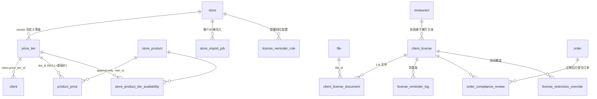

# Ocean Island 开发方案 —— 表结构修改设计

> 基线：**v20260705 代码**（`C:\github-code\chain-serve\v20260705\`，alembic head = `3bdd9e1f06c8`）+ **preprod 数据库**（`backups\preprod_20260716\`，`alembic_version = 3bdd9e1f06c8`，两者完全同版）。所有 DDL 均对照 `preprod_main_schema_20260716.sql` 的真实结构设计，所有新迁移基于 `3bdd9e1f06c8` 续写。
> 关联文档：[开放问题确认单](开放问题确认单.md)（Q1/Q2/Q5 的答案直接影响本方案个别表）· [需求分析与功能需求列表](需求分析与功能需求列表.md)（FR 编号）· [开发计划](开发计划.md)
> 编制日期：2026-07-16。

---

## 一、基线核查结论（v20260705 相对旧分析的关键差异）

开发前用 4 个并行调研核对了新版代码，直接影响设计的发现：

| # | 发现 | 对设计的影响 |
|---|------|--------------|
| 1 | `payment_method` 表（2026-05 新增）= "系统预置 + 用户自定义"字典表范式（name unique / is_system / created_by_user_id，系统项删除返回 409），domain 在 `core/payment_methods/` | **price_tier 表直接照抄此范式**，是原团队现成且有测试覆盖的模板 |
| 2 | `vendor_product` 新增的 `cost_price/sell_price/markup/margin` 四字段是"报价（quotation epic）"**预留字段，当前全库无写入路径**，不参与下单取价 | **价格等级不建在 vendor_product 上**，建在 StoreProduct/ProductPrice 侧；两者分层互补不冲突 |
| 3 | `store_product` 已有 **`name_en` / `name_zh`** 双语品名列（迁移 `c5e8f1a2b3d4` 由 name/alternative_name 改名而来），后端搜索已含 name_zh（ilike+相关性打分），前端已有 ZH Name 列 | 产品中文名**零 DDL**；注意 API 读写键不一致（读 `alternative_name`、写 `name_zh`） |
| 4 | `CompanyAuditLog` 已扩展：entity_type 现有 COMPANY/SUBSCRIPTION/CONTACT_PERSON/PHONE_NUMBER，action 约 24 种，有成熟的 per-field 审计写入与测试 | 审计**不建新表**，扩展此表的 entity_type/action 即可 |
| 5 | 会话单会话模型被**强化**：JWT `sid` 与 Redis 逐请求比对，新登录立即使旧设备失效；改密/重置仍不吊销；无管理员踢出端点 | 多设备 30 天登录必须动会话存储结构（新表 `user_session`） |
| 6 | `BusinessType` 代码已含 MANUFACTURER（与 DB 对齐），多 company_type 层级体系（company_company_type/category/subcategory）完备；company_type 种子仍 6 行 | 加 LIQUOR_VENDOR = 纯种子迁移 + 前端第 7 张卡，**无需改任何枚举** |
| 7 | 执照表（restaurant_license/store_license）、订单链路插入点（`OrdersService.create_order` / `confirm_vendor_order`）、S3 public-read、catalog_ocr 鉴权注释、delete_file TODO——均与旧分析一致 | 旧方案照用；S3 私有化仍是执照功能前置项 |
| 8 | 导入有两代范式：admin 的 `import_session` 会话式管道（只导公司）；厂商域的 `manufacturer_catalog_import_job` **prepare→commit 两阶段**（幂等、防重复提交） | 客户/价格导入仿**后者**建 `store_import_job`；勿学旧 OCR webhook 直写业务表 |
| 9 | `orderevent`/`orderstatus` 为 PG enum；已有未接入的 `ExtendedOrderStatus`（PAID/OVERDUE，TODO）；原团队有 `pricingmode` enum 大小写不一致的坑 | **新增状态类字段一律用 varchar + 应用层 StrEnum**，只有 orderevent 加值时才动 PG enum |

⚠️ 环境注意：本地旧 `css_dev`（GitHub main schema + db_compare 补丁）与本方案**不兼容且已作废**——开发库应从 preprod dump 恢复或在空库上 `alembic upgrade head`（v20260705 代码）重建。

---

## 二、表结构修改总览

**新增 10 张表、修改 6 张表、新增 0 个 PG 枚举**（状态字段全部 varchar + 应用层 StrEnum，仅 `orderevent` 现有枚举追加值）：

| 模块 | 新增表 | 修改表 |
|------|--------|--------|
| 实体权限 | —（纯种子数据） | —（company_type/api_entity/permission/role/company_role_permission 插行） |
| 会话 | `user_session` | `issued_token` +1 列；`company` +1 列 |
| 语言 | — | `user` +1 列；`company` +1 列 |
| 价格等级 | `price_tier`、`store_product_tier_availability`、`store_import_job` | `client` +1 列；`product_price` +3 列 |
| 执照合规 | `client_license`、`client_license_document`、`license_reminder_rule`、`license_reminder_log`、`order_compliance_review`、`license_restriction_override` | `company_audit_log`（details→text +索引） |
| 通知 | `notification_event_preference` | — |

新表关系（酒类两大核心域）：



---

## 三、逐模块 DDL 设计

### 3.1 实体与权限（FR-A1~A4）—— 纯种子迁移，无 DDL

新版多类型体系（`company_company_type` + `category`）已完备，`company.type` 由 onboarding 按所选 company_type 的共享 category 自动推导。只需插种子行：

```sql
-- 迁移 ①：seed_liquor_vendor_company_type
INSERT INTO company_type (id, name, category, created_at, updated_at)
VALUES ('<固定UUID>', 'Liquor Vendor', 'VENDOR', now(), now());
-- 按 seed_company_hierarchy（c5c2f5a9b5be）同样模式补：
--   company_category('Liquor Vendor') + company_type_category 关联
--   （如产品要求子分类，再补 company_subcategory 关联，首期可不做）

-- 迁移 ②：seed_liquor_api_entities_and_permissions
INSERT INTO api_entity (id, name) VALUES
  ('<UUID>', 'price_tier'), ('<UUID>', 'customer_license'),
  ('<UUID>', 'license_review'), ('<UUID>', 'compliance_override');
-- 注意：permission 表是全局 4 行动作类型（create/view/edit/delete，d2cfa5cf0e97 已种），无需插行；
-- "权限×实体"由 company_role_permission(company_id, role_id, permission_id, entity_id) 三元组表达。
-- 新公司经 onboarding 自动获得权限矩阵；为存量公司开通时才需要 company_role_permission 数据迁移：
--   price_tier / customer_license：授予 CEO/CFO/Manager
--   license_review / compliance_override：仅 CEO/CFO（+ Compliance Manager，见下）

-- 迁移 ③（视 Q7 确认）：seed_compliance_manager_role
INSERT INTO role (id, type, belongs_to_company, name)
VALUES ('<固定UUID>', 'VENDOR', true, 'Compliance Manager');
-- ⚠️ 此 UUID 必须同步硬编码到前端 constants/roles.ts 的 UserRole
```

要点：
- **不改** `CompanyTypeEnum` / `BusinessType` / PG 枚举——Liquor Vendor 落在 category=VENDOR 下自动复用全套 VENDOR 角色与 store 业务结构。
- 敏感端点用现成写法 `check_permissions(required_permissions=[...], required_roles=[RoleName.CEO, RoleName.CFO, ...])`。
- 注意新版已删除 VENDOR 的 Chef 角色（迁移 `a3f1c9d27b84`），授权种子不要引用它。
- 前端配套（无 DDL 但必做，否则卡片不出现）：`CompanyTypes.LIQUOR_VENDOR`、`NAME_TO_COMPANY_TYPE['Liquor Vendor']`、businessCards 第 7 张卡、i18n 文案。

### 3.2 持久会话（FR-B1~B6）

**新表 `user_session`** —— 把"Redis 单值会话"升级为"DB 权威 + Redis 缓存"的多设备会话。JWT 的 `sid` 即本表主键：

```sql
CREATE TABLE user_session (
    id              uuid PRIMARY KEY,                -- = JWT sid
    user_id         uuid NOT NULL REFERENCES "user"(id) ON DELETE CASCADE,
    device_id       varchar(36)  NOT NULL,           -- 沿用现有 device_id 语义
    device_name     varchar(255),                    -- 客户端上报（UA 解析），可空
    ip_address      varchar(45),
    user_agent      varchar(512),
    expires_at      timestamptz  NOT NULL,           -- 登录时间 + 会话策略 TTL
    last_active_at  timestamptz  NOT NULL DEFAULT now(),
    revoked_at      timestamptz,                     -- NULL=活跃
    revoked_by_user_id uuid REFERENCES "user"(id) ON DELETE SET NULL,
    revoke_reason   varchar(50),                     -- LOGOUT/PASSWORD_CHANGE/ADMIN_KICK/EXPIRED
    created_at      timestamptz  NOT NULL DEFAULT now(),
    updated_at      timestamptz  NOT NULL,
    deleted_at      timestamptz
);
CREATE INDEX ix_user_session_user_id ON user_session(user_id) WHERE revoked_at IS NULL;
CREATE INDEX ix_user_session_expires_at ON user_session(expires_at);
```

**修改 `issued_token`**（现有列：jti/subject_id/device_id/expired_at/revoked）：

```sql
ALTER TABLE issued_token ADD COLUMN session_id uuid
    REFERENCES user_session(id) ON DELETE SET NULL;   -- 存量行为 NULL，新签发必填
CREATE INDEX ix_issued_token_session_id ON issued_token(session_id) WHERE NOT revoked;
```

**修改 `company`**（实体级会话时长，NULL = 用全局 env 默认；不另建配置表）：

```sql
ALTER TABLE company ADD COLUMN session_ttl_seconds integer;  -- Ocean Island 配 2592000（30 天）
```

配套代码改动（无 DDL）：Redis 键从 `user_session:{user_id}`（单值）改为 per-sid 缓存；`verify_access_token` 的 sid 校验改查"该 sid 是否活跃"而非"是否等于唯一值"；`change_password`/`reset_password` 补"吊销该用户全部 session + token"；新增 admin 端点踢单会话/全部会话（写 `revoked_at/revoke_reason`）；`access_token_ttl` 由 8h 缩短至 15min（env 即可）。

### 3.3 语言（FR-C3）—— 2 列

```sql
ALTER TABLE "user"  ADD COLUMN language varchar(8);           -- 'en'/'zh'，NULL=en
ALTER TABLE company ADD COLUMN default_language varchar(8);   -- 实体默认语言，NULL=en
```

产品中文名**不需要任何 DDL**：`store_product.name_en/name_zh` 已在位且搜索已支持。前端录入时注意写键为 `name_zh`（camel 后 `nameZh`）、读键为序列化别名 `alternativeName`。UI 翻译、语言选择器、X-Language 头均为代码改动，无表结构。

### 3.4 价格等级（FR-D1~D10）

#### 3.4.1 新表 `price_tier`（照抄 payment_method 范式 + store 维度 + 管理属性）

```sql
CREATE TABLE price_tier (
    id                 uuid PRIMARY KEY,
    store_id           uuid NOT NULL REFERENCES store(id) ON DELETE CASCADE,  -- vendor 维度
    name               varchar(100) NOT NULL,
    description        varchar(500),
    is_active          boolean NOT NULL DEFAULT true,
    is_default         boolean NOT NULL DEFAULT false,   -- 新客户自动落入的默认等级
    sort_order         integer NOT NULL DEFAULT 0,
    archived_at        timestamptz,                      -- 归档（区别于删除）
    created_by_user_id uuid REFERENCES "user"(id) ON DELETE SET NULL,
    created_at         timestamptz NOT NULL DEFAULT now(),
    updated_at         timestamptz NOT NULL,
    deleted_at         timestamptz
);
CREATE UNIQUE INDEX uq_price_tier_store_name ON price_tier(store_id, name)
    WHERE deleted_at IS NULL;
CREATE UNIQUE INDEX uq_price_tier_store_default ON price_tier(store_id)
    WHERE is_default AND deleted_at IS NULL;             -- 每 store 至多一个默认等级
```

> 等级集合是 **store（vendor）级统一维度**（Q2 建议方案 A）；数量与命名完全自由，满足需求 §7.1"A/B/C/D、Level 1-5、Gold/Silver 或任意名称"。

#### 3.4.2 修改 `product_price` —— 加 tier 维度 + 审计（方案 A：复用 append-only）

现有 `product_price` 是 append-only 历史表（改价=插新行，当前价=最新一行），**这正是需求 §7.8"价格审计历史"要的语义**，所以选择在原表加维度而非另建价格表：

```sql
ALTER TABLE product_price
    ADD COLUMN tier_id            uuid REFERENCES price_tier(id) ON DELETE RESTRICT,
                                       -- NULL = 基础价（向后兼容：存量行全部是基础价）
    ADD COLUMN changed_by_user_id uuid REFERENCES "user"(id) ON DELETE SET NULL,
    ADD COLUMN import_job_id      uuid;                  -- 关联 store_import_job，手工改价为 NULL

CREATE INDEX ix_product_price_product_tier_created
    ON product_price(product_id, tier_id, created_at DESC);
```

**必须同步的代码点**：`StoreProduct.price` 的 column_property（`products/models.py:191-200`）当前取"最新一条"，加 tier 后必须补 `tier_id IS NULL` 过滤，否则基础价会错误地取到 tier 价——这是本方案唯一"不改会静默出错"的点，列为代码评审必查项。tier 当前价 = 按 `(product_id, tier_id)` 取 `created_at` 最新一行（与现有查询同构）。

> 若 Q1 确认"不保留基础价"（选项 B），DDL 不变——只是应用层不再写 tier_id=NULL 的新行。

#### 3.4.3 新表 `store_product_tier_availability`（三态可购性）

```sql
CREATE TABLE store_product_tier_availability (
    id                 uuid PRIMARY KEY,
    store_product_id   bigint NOT NULL REFERENCES store_product(id) ON DELETE CASCADE,
    tier_id            uuid   NOT NULL REFERENCES price_tier(id)    ON DELETE CASCADE,
    availability       varchar(16) NOT NULL DEFAULT 'AVAILABLE',    -- AVAILABLE / UNAVAILABLE
    updated_by_user_id uuid REFERENCES "user"(id) ON DELETE SET NULL,
    created_at         timestamptz NOT NULL DEFAULT now(),
    updated_at         timestamptz NOT NULL,
    deleted_at         timestamptz,
    CONSTRAINT uq_sptavail UNIQUE (store_product_id, tier_id)
);
```

三态判定规则（应用层，需求 §7.5/§7.6）：

| 该 (产品×等级) 的数据 | 客户看到 |
|---|---|
| 有 tier 价 且 无 UNAVAILABLE 行 | 正常价格，可购 |
| 任意价格状态 + availability=UNAVAILABLE | 不展示/不可购 |
| **无 tier 价**（无论 availability） | "请联系供应商询价"，不可加购，**不回退基础价或他 tier 价** |

#### 3.4.4 修改 `client` —— 等级分配

```sql
ALTER TABLE client ADD COLUMN price_tier_id uuid
    REFERENCES price_tier(id) ON DELETE RESTRICT;   -- RESTRICT 兜底"已分配等级不可删"（FR-D2）
CREATE INDEX ix_client_price_tier_id ON client(price_tier_id);
```

应用层规则：新建/导入客户未指定 tier 时落入该 store 的 `is_default` 等级；"每个活跃客户必须有等级"由服务层校验（存量 client 由数据迁移统一赋默认等级）。tier 变更写审计（`company_audit_log`，entity_type=`CLIENT_TIER`）。

#### 3.4.5 新表 `store_import_job`（客户/价格导入，FR-D7/D8）

仿厂商域 `manufacturer_catalog_import_job` 的 **prepare→commit 两阶段**（幂等、防重复提交、错误报告），不学旧 OCR webhook 直写：

```sql
CREATE TABLE store_import_job (
    id                   uuid PRIMARY KEY,
    store_id             uuid NOT NULL REFERENCES store(id) ON DELETE CASCADE,
    kind                 varchar(20) NOT NULL,     -- CLIENT / TIER_PRICE
    source               varchar(16) NOT NULL DEFAULT 'FILE',   -- FILE / PASTE
    file_id              uuid REFERENCES file(id) ON DELETE SET NULL,
    status               varchar(20) NOT NULL DEFAULT 'CREATED',
                         -- CREATED/PARSED/VALIDATED/COMMITTING/COMPLETED/FAILED
    column_mapping       json,
    total_rows           integer NOT NULL DEFAULT 0,
    imported_rows        integer NOT NULL DEFAULT 0,
    skipped_rows         integer NOT NULL DEFAULT 0,
    error_report         json,                     -- 逐行错误 [{row, field, error}]
    requested_by_user_id uuid NOT NULL REFERENCES "user"(id) ON DELETE RESTRICT,
    committed_at         timestamptz,
    created_at           timestamptz NOT NULL DEFAULT now(),
    updated_at           timestamptz NOT NULL,
    deleted_at           timestamptz
);
CREATE INDEX ix_store_import_job_store ON store_import_job(store_id, created_at DESC);
```

客户导入列：客户名/客户 ID/价格等级/执照编号/执照到期日（§7.7）——后两列写入 3.5 的 `client_license`。价格导入列：SKU/产品名/等级名/价格/可购状态；等级名不匹配→逐行报错进 `error_report`。

### 3.5 执照合规（FR-E1~E7、F5、F6）

**决策：新建 `client_license`，不扩展 `restaurant_license`**。理由：现有表是海鲜执照（enum 类型写死 4 种、NOT NULL 约束、由 Settings 表单直写），语义与"vendor 主导审核的合规执照"不同；强行复用会把两套生命周期搅在一起。执照挂 `restaurant_id`（餐厅主体，Q5 建议 A）——一家餐厅只有一套执照，对多个 vendor 复用；存量海鲜执照数据按 Q8 结论决定是否迁入。

#### 3.5.1 新表 `client_license`（核心档案 + 状态机）

```sql
CREATE TABLE client_license (
    id                    uuid PRIMARY KEY,
    restaurant_id         uuid NOT NULL REFERENCES restaurant(id) ON DELETE CASCADE,
    license_holder_name   varchar(255),               -- 执照持有人法定名称
    business_name         varchar(255),
    license_number        varchar(100) NOT NULL,
    license_type          varchar(100) NOT NULL,      -- 可配置字典（varchar，不用 PG enum）
    issuing_authority     varchar(255),
    issuing_region        varchar(64),                -- 州/司法辖区（varchar 以兼容非美辖区）
    effective_date        date,
    expiration_date       date,                       -- 审核通过前允许为空
    status                varchar(32) NOT NULL DEFAULT 'NOT_SUBMITTED',
        -- NOT_SUBMITTED / PENDING_REVIEW / VERIFIED / EXPIRING_SOON /
        -- EXPIRED / REJECTED / SUSPENDED / MANUAL_REVIEW_REQUIRED   （8 态，应用层 StrEnum）
    verified_at           timestamptz,
    verified_by_user_id   uuid REFERENCES "user"(id) ON DELETE SET NULL,
    review_notes          text,                       -- 驳回/复核内部备注（客户不可见）
    compliance_contact_name  varchar(255),
    compliance_contact_email varchar(255),
    compliance_contact_phone varchar(50),
    created_by_user_id    uuid REFERENCES "user"(id) ON DELETE SET NULL,
    created_at            timestamptz NOT NULL DEFAULT now(),
    updated_at            timestamptz NOT NULL,
    deleted_at            timestamptz
);
CREATE INDEX ix_client_license_restaurant ON client_license(restaurant_id) WHERE deleted_at IS NULL;
CREATE INDEX ix_client_license_status     ON client_license(status) WHERE deleted_at IS NULL;
CREATE INDEX ix_client_license_expiration ON client_license(expiration_date)
    WHERE status IN ('VERIFIED','EXPIRING_SOON') AND deleted_at IS NULL;   -- 到期扫描专用
```

设计要点：
- **1:N**：一家餐厅可持多张执照（多州/多类型，需求 §12.3 预留），"下单需要哪张执照有效"由应用层按 license_type 规则判定（首期：任一 VERIFIED 即可，规则可配置）。
- `EXPIRING_SOON`/`EXPIRED` 由每日 arq cron 从 `expiration_date` 派生写回（照抄 `check_unregistered_clients` 模式），保证仪表盘/阻断读状态时无需现算。
- 状态用 varchar + 应用层 StrEnum（规避 PG enum ADD VALUE 的迁移痛点与原团队 pricingmode 大小写坑）。

#### 3.5.2 新表 `client_license_document`（文件，复用 file 表）

```sql
CREATE TABLE client_license_document (
    id                  uuid PRIMARY KEY,
    license_id          uuid NOT NULL REFERENCES client_license(id) ON DELETE CASCADE,
    file_id             uuid NOT NULL REFERENCES file(id) ON DELETE RESTRICT,
    is_current          boolean NOT NULL DEFAULT true,   -- 换证后旧文件保留但标非当前
    uploaded_by_user_id uuid REFERENCES "user"(id) ON DELETE SET NULL,
    created_at          timestamptz NOT NULL DEFAULT now(),
    updated_at          timestamptz NOT NULL,
    deleted_at          timestamptz
);
CREATE INDEX ix_cld_license ON client_license_document(license_id);
```

前置（FR-E0，无 DDL）：上传走新的 **S3 私有前缀**（`licenses/`），`BotocoreUploader` 对该前缀改 `private` ACL + 预签名 URL 下载（或后端代理）；允许类型 `[application/pdf, image/jpeg, image/png]`、上限建议 20MB（复用 `parse_file` 校验）。

#### 3.5.3 新表 `license_reminder_rule` + `license_reminder_log`（可配置提醒 + 防重发）

```sql
CREATE TABLE license_reminder_rule (
    id          uuid PRIMARY KEY,
    store_id    uuid NOT NULL REFERENCES store(id) ON DELETE CASCADE,
    days_before integer NOT NULL,                  -- 60/30/14/7/1/0（种子默认 6 档，可增删）
    is_on       boolean NOT NULL DEFAULT true,
    created_at  timestamptz NOT NULL DEFAULT now(),
    updated_at  timestamptz NOT NULL,
    deleted_at  timestamptz,
    CONSTRAINT uq_lrr UNIQUE (store_id, days_before)
);

CREATE TABLE license_reminder_log (
    id          uuid PRIMARY KEY,
    license_id  uuid NOT NULL REFERENCES client_license(id) ON DELETE CASCADE,
    days_before integer NOT NULL,
    expiration_date date NOT NULL,   -- 快照：换证改期后同档位可重新提醒
    channel     varchar(16) NOT NULL,             -- IN_APP / EMAIL / SMS
    sent_at     timestamptz NOT NULL DEFAULT now(),
    CONSTRAINT uq_lrl UNIQUE (license_id, expiration_date, days_before, channel)
);
```

每日 cron：扫 `ix_client_license_expiration` → 命中档位且 `license_reminder_log` 无记录 → 走现成三通道（站内 RabbitMQ / 邮件 Kafka→SMTP / 短信 Kafka→Twilio）→ 落 log。

#### 3.5.4 新表 `order_compliance_review`（已提交订单遇过期，FR-F5，仿 OrderClaim）

```sql
CREATE TABLE order_compliance_review (
    id                  uuid PRIMARY KEY,
    order_id            bigint NOT NULL REFERENCES "order"(id) ON DELETE CASCADE,   -- order.id 是 bigint
    license_id          uuid REFERENCES client_license(id) ON DELETE SET NULL,
    reason              varchar(64) NOT NULL,      -- LICENSE_EXPIRED_AFTER_SUBMIT / ...
    status              varchar(20) NOT NULL DEFAULT 'NEW',   -- NEW/PROCESSING/RESOLVED（仿 order_claim）
    resolution          varchar(32),               -- PROCEED / CANCEL / OVERRIDDEN
    resolution_notes    text,
    resolved_by_user_id uuid REFERENCES "user"(id) ON DELETE SET NULL,
    resolved_at         timestamptz,
    created_at          timestamptz NOT NULL DEFAULT now(),
    updated_at          timestamptz NOT NULL,
    deleted_at          timestamptz
);
CREATE INDEX ix_ocr_order ON order_compliance_review(order_id);
CREATE INDEX ix_ocr_status ON order_compliance_review(status) WHERE status <> 'RESOLVED';
```

**不改 `orderstatus` 枚举**（避开未接入的 ExtendedOrderStatus），合规挂起用本表表达；订单事件走 `order_history`，需 `orderevent` PG enum 追加值：

```sql
-- ⚠️ ADD VALUE 不能在事务内执行，alembic 中需 autocommit block
ALTER TYPE orderevent ADD VALUE IF NOT EXISTS 'LICENSE_BLOCKED';
ALTER TYPE orderevent ADD VALUE IF NOT EXISTS 'COMPLIANCE_REVIEW_OPENED';
ALTER TYPE orderevent ADD VALUE IF NOT EXISTS 'COMPLIANCE_OVERRIDDEN';
```

#### 3.5.5 新表 `license_restriction_override`（授权覆盖，FR-F6，需求 §8.10 全字段必填）

```sql
CREATE TABLE license_restriction_override (
    id                    uuid PRIMARY KEY,
    license_id            uuid NOT NULL REFERENCES client_license(id) ON DELETE CASCADE,
    client_id             bigint NOT NULL REFERENCES client(id) ON DELETE CASCADE,
    order_id              bigint REFERENCES "order"(id) ON DELETE SET NULL,   -- 针对单笔订单的覆盖（order.id 是 bigint）
    reason                text NOT NULL,
    notes                 text,
    authorized_by_user_id uuid NOT NULL REFERENCES "user"(id) ON DELETE RESTRICT,
    expires_at            timestamptz,              -- 覆盖有效期，NULL=仅本单
    created_at            timestamptz NOT NULL DEFAULT now(),
    updated_at            timestamptz NOT NULL,
    deleted_at            timestamptz
);
CREATE INDEX ix_lro_client ON license_restriction_override(client_id, created_at DESC);
```

#### 3.5.6 审计 —— 扩展 `company_audit_log`（不建新表）

entity_type/action 是 varchar 列，只改应用层枚举 + 一条 DDL：

```sql
ALTER TABLE company_audit_log ALTER COLUMN details TYPE text;   -- 现 varchar(1000) 不够存前值/后值 JSON
CREATE INDEX ix_cal_company_entity_created
    ON company_audit_log(company_id, entity_type, created_at DESC);
```

应用层 `AuditEntityTypeEnum` 追加：`LICENSE`、`PRICE_TIER`、`CLIENT_TIER`、`TIER_PRICE`、`SESSION`；`AuditActionEnum` 追加：`LICENSE_UPLOADED/SUBMITTED/VERIFIED/REJECTED/UPDATE_REQUESTED/SUSPENDED/EXPIRED`、`ORDER_BLOCKED`、`OVERRIDE_GRANTED`、`TIER_ASSIGNED`、`PRICE_CHANGED`、`SESSION_REVOKED` 等。`details` 存结构化 JSON（`{"field","old","new","import_job_id"...}`），满足需求 §11"前值/后值"。

### 3.6 通知事件偏好（FR-H1/H2）—— 新表 `notification_event_preference`

现有 `notification` 表只有 EMAIL/TEXT/CHATS 三个粗开关（PG enum `notificationtype`），承载不了"12 类事件 × 通道 × 收件人"配置。新表按事件粒度扩展、不动老表：

```sql
CREATE TABLE notification_event_preference (
    id         uuid PRIMARY KEY,
    company_id uuid NOT NULL REFERENCES company(id) ON DELETE CASCADE,
    role_id    uuid REFERENCES role(id) ON DELETE CASCADE,   -- NULL = 公司级默认
    event_type varchar(50) NOT NULL,
        -- LICENSE_UPLOADED / LICENSE_PENDING_REVIEW / LICENSE_APPROVED / LICENSE_REJECTED /
        -- LICENSE_UPDATE_REQUESTED / LICENSE_EXPIRING / LICENSE_EXPIRED / ORDER_BLOCKED /
        -- CLIENT_TIER_CHANGED / TIER_PRICE_CHANGED / IMPORT_CLIENT_NO_TIER / IMPORT_CLIENT_NO_LICENSE
    channels   varchar(16)[] NOT NULL DEFAULT '{IN_APP}',    -- IN_APP/EMAIL/SMS
    is_on      boolean NOT NULL DEFAULT true,
    created_at timestamptz NOT NULL DEFAULT now(),
    updated_at timestamptz NOT NULL,
    deleted_at timestamptz,
    CONSTRAINT uq_nep UNIQUE (company_id, role_id, event_type)
);
```

---

## 四、Alembic 迁移序列（基于 3bdd9e1f06c8 续写，全部实现 downgrade）

| # | 迁移 | 内容 | 风险 |
|---|------|------|------|
| M1 | `seed_liquor_vendor_company_type` | §3.1 迁移① | 低（纯 INSERT，downgrade=DELETE） |
| M2 | `seed_liquor_api_entities_permissions` | §3.1 迁移②（+③视 Q7） | 低 |
| M3 | `add_user_session_and_token_session_fk` | user_session 表 + issued_token.session_id + company.session_ttl_seconds | 低（全部可空/新表） |
| M4 | `add_user_language` | user.language + company.default_language | 低 |
| M5 | `add_price_tier_tables` | price_tier + availability 表 + client.price_tier_id + product_price 3 列与索引 | 中（product_price 大表加索引用 `CREATE INDEX CONCURRENTLY` 或维护窗口） |
| M6 | `backfill_default_tier_for_existing_clients` | 数据迁移：给启用 tier 的 store 的存量 client 赋默认等级（仅 Ocean Island，可空跑） | 低 |
| M7 | `add_client_license_tables` | client_license + document + reminder_rule/log + 种子默认 6 档提醒 | 低 |
| M8 | `add_order_compliance_and_override` | order_compliance_review + license_restriction_override + **orderevent ADD VALUE（autocommit）** | 中（enum ADD VALUE 需独立 autocommit 块，不可回滚——downgrade 留空并注释） |
| M9 | `add_notification_event_preference` | §3.6 新表 | 低 |
| M10 | `extend_company_audit_log` | details→text + 复合索引 | 低（类型放宽无锁风险小；索引 CONCURRENTLY） |

执行环境注意：
- 开发库 = v20260705 代码空库 `upgrade head` 或从 `preprod_main_full_20260716.dump` 恢复后续跑 M1-M10；**旧 css_dev（GitHub main 版）作废，禁止在其上跑这些迁移**。
- preprod/test 发布顺序：先 `alembic upgrade`（M1-M10 全部向后兼容，老代码可与新 schema 共存）→ 再滚动发新镜像。
- `orderevent ADD VALUE` 与 `CREATE INDEX CONCURRENTLY` 都不能在事务内：放独立迁移、用 alembic 的 `autocommit_block()`。

---

## 五、代码落点速查（配合表结构）

| 模块 | 后端 | 前端 |
|------|------|------|
| 实体 | 种子迁移；`onboardings/services.py` 无需改（category 推导现成） | `models/common/api.ts`、`SelectBusinessStep/constants.ts`（第 7 张卡 + NAME_TO_COMPANY_TYPE）、`constants/permissions.ts` |
| 会话 | 新 `core/auth/sessions/`（SessionService 重构为多会话）、`tokens/services.py`（issue/verify 带 session 表）、`users/services.py` + `auth/services.py`（改密吊销）、新 admin 端点 | `models/errors.ts` 补 SESSION_EXPIRED 处理、登出跳转；设置页"设备列表" |
| 语言 | `user`/settings API 加 language；X-Language 中间件（二期） | `config/i18n/i18n.ts`、`public/locales/zh/`、`LanguageContent` 激活、Catalog 等硬编码改造、`formatCurrency`/`datetime` |
| 等级 | 新 `core/price_tiers/` 五件套 + `main_app/vendor/price_tiers/`；改 `StoreProduct.price` column_property（**tier_id IS NULL 过滤**）与 `_build_calc_input` 按 client.tier 取价；`store_import_job` 导入 service（仿 manufacturer_catalog_imports prepare→commit） | tier 管理页、产品×tier 定价矩阵、客户分配、导入向导 |
| 执照 | 新 `core/licenses/` 五件套 + `main_app/vendor/licenses/` + 餐厅端自助上传端点；cron 任务（仿 `check_unregistered_clients`）；`OrdersService.create_order` + `confirm_vendor_order` 插校验；合规状态只读接口 | Client 页新 License tab（审核 UI 仿 RecognizedInvoice）、餐厅端上传页、下单阻断提示、合规仪表盘 |
| 通知 | 12 类事件接入三通道 + `notification_event_preference` 读取 | 通知设置页扩展 |

---

## 六、待客户确认项对表结构的影响（联动开放问题确认单）

| 问题 | 若客户不选建议方案，表结构变化 |
|------|-------------------------------|
| Q1 基础价 | 选 B（无基础价）：DDL 不变，仅应用层不写 tier_id=NULL 行；选 C（基础价兜底）：DDL 不变，读路径加回退逻辑（不建议） |
| Q2 等级维度 | 选 B（每产品自有等级集合）：`price_tier` 需加 `store_product_id` 维度并放弃 `client.price_tier_id` 单值分配——**模型重构级变化**，务必先确认 |
| Q5 执照挂载 | 选 B（含 vendor 自身执照）：`client_license.restaurant_id` 改为多态挂载（restaurant_id/store_id 二选一 + CHECK XOR，参考 `vendor_product` 的 XOR 约束写法） |
| Q7 角色 | 选 B（加 Administrator）：多一行 role 种子 + 前端 UserRole UUID |
| Q9 多设备 | 选 B（维持单设备）：`user_session` 仍建（为审计与踢出），仅应用层限制每用户一个活跃行 |
