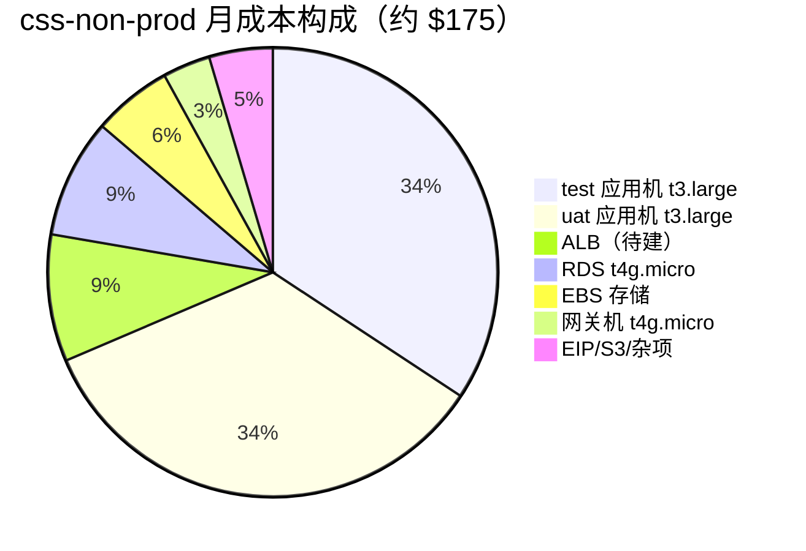
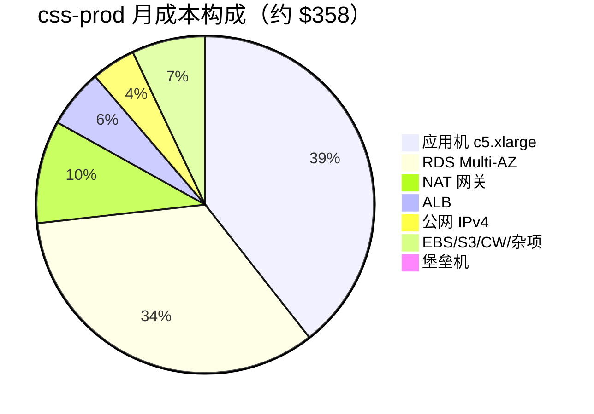

# 两个 AWS 群组的价格图表（css-non-prod / css-prod）

> us-east-1 按需价，2026-07 估算（未含税/流量波动）。⚠️ 账号现为 FREE plan（剩 $53.87 credits），**产生下列费用前须升级 Paid plan**。

## css-non-prod（test + uat）：约 **$175/月**

| 项目 | 规格 | 单价估算 | 月费 |
|------|------|----------|------|
| EC2 test 应用机 | t3.large（2c8G） | $0.0832/h | ~$60 |
| EC2 uat 应用机 | t3.large（2c8G） | $0.0832/h | ~$60 |
| 网关机（堡垒+NAT+反代） | t4g.micro（✅ 已建 `css-nonprod-gw`） | $0.0084/h | ~$6 |
| RDS css-non-prod | db.t4g.micro 单 AZ（✅ 已在新 VPC 建成，PG16.14） | — | ~$15 |
| ALB（nonprod，待建） | 基础费 + LCU（等应用机+域名后创建） | ~$0.0225/h | ~$16 + LCU |
| EBS | gp3 50G ×2 + 30G | $0.08/G | ~$10 |
| EIP/公网 IPv4 | 1 个 | $3.65/个 | ~$4 |
| S3 / 流量 / 杂项 | — | — | ~$4 |

## css-prod（生产）：约 **$358/月**（初期 c5.large 档约 $288）

| 项目 | 规格 | 月费 |
|------|------|------|
| EC2 prod 应用机 | c5.xlarge（4c8G）；初期可 c5.large（2c4G ~$70）观察 | ~$140 |
| 堡垒机 | t4g.nano（平时可 stop，更低） | ~$3 |
| NAT 网关 | 托管 + 流量 | ~$35 |
| RDS css-prod | db.t4g.medium **Multi-AZ** + 备份存储 | ~$120 |
| ALB | 基础 + LCU | ~$20 |
| 公网 IPv4 ×4（ALB×2/NAT/堡垒） | $3.65/个 | ~$15 |
| EBS / S3 / CloudWatch / 杂项 | — | ~$25 |

## 合计与优化空间

| | 月费 | 年费 |
|---|------|------|
| 两群组合计（prod 用 c5.xlarge） | **~$533/月** | ~$6,400/年 |
| 两群组合计（prod 先用 c5.large） | **~$463/月** | ~$5,560/年 |

优化选项（按性价比排序）：
1. **预留实例 / Savings Plan**（1 年期）：EC2+RDS 可再降 30~40% → 合计约 $330~380/月；
2. prod 初期用 c5.large（-$70/月），负载上来再无缝升配；
3. 堡垒机平时 stop（-$3/月 + IPv4 费保留）；
4. 非生产夜间/周末停 test/uat 应用机（脚本化 start/stop，最多再省 ~$70/月，代价是随用随起）；
5. prod NAT 网关换 fck-nat 实例（-$29/月，代价是多一台自维护实例，**不推荐生产用**）。
