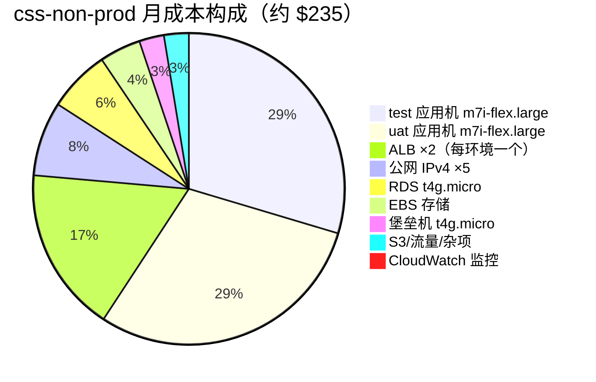
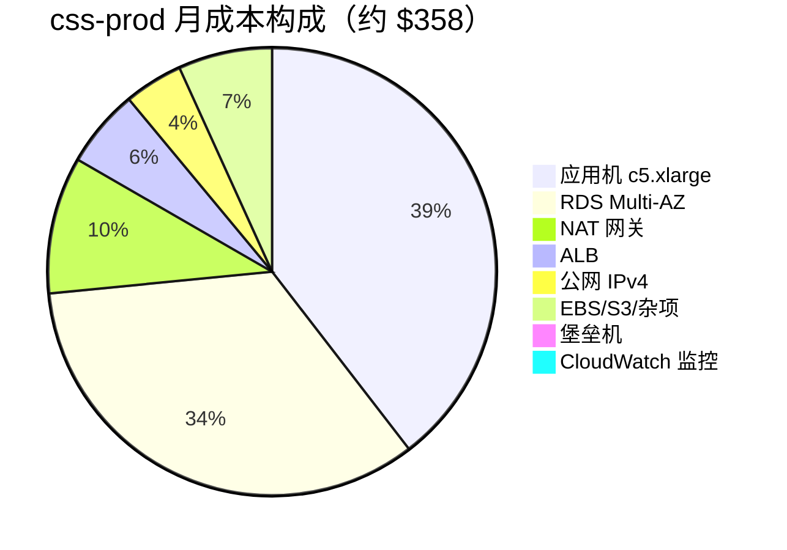

# CSS 新账号成本价格表

> ⚠️ **2026-07-30 用 Cost Explorer 实测校准**：下面各表是**按需价的理论估算**，
> 而**实际账单只有估算的一半左右**。以实测为准做预算，用估算做上限参考。

## 实测：真实每日花费（Cost Explorer，credits 抵扣前的真实用量；2026-07-31 重取）

| 日期 | 真实用量 |
|------|---------|
| 2026-07-25 ~ 27 | $3.10/天 |
| 2026-07-28（新建 2 台应用机 + 2 个 ALB） | $4.89/天 |
| 2026-07-29（变更峰值日，见下注） | $7.23/天 |
| 2026-07-30（**当前最新完整天**） | **$4.54/天** |

> 07-29 为什么高：当天集中做了 SG 拆分（新旧双挂）、监控上线、kafka-ui ALB 创建等大量变更，
> 新旧资源并行计费；且初版文档在 07-30 早晨读到的 "$3.40" 后来被账单管道**重述上调**到 $7.23——
> Cost Explorer 的当日数字要 1~2 天才稳定，看趋势以"完整落账日"为准。

**最新完整天（7-30）按服务拆分：**

| 服务 | 日 | 折月 | 理论估算 | 实测/估算 |
|------|-----|------|---------|----------|
| EC2 计算（2 台应用机 + 2 台堡垒机） | $2.65 | **$80** | $150 | 53% |
| ELB（3 个 ALB：test / uat / entry） | $0.90 | **$27** | $60 | 45% |
| VPC（公网 IPv4：2 EIP + 6 个 ALB 节点） | $0.53 | **$16** | $29 | 55% |
| RDS（db.t4g.micro + 20GB） | $0.27 | **$8** | $14 | 57% |
| EC2-Other（EBS 卷） | $0.13 | **$4** | $10 | 40% |
| ECR / Secrets Manager / 杂项 | $0.06 | **$2** | $9 | — |
| **合计** | **$4.54** | **≈ $136/月** | ~$272 | **50%** |

**为什么实际只有估算的一半**：账号处于 AWS Free Plan，credits 全额抵扣了这些用量
（Cost Explorer 里 Usage 与 Credit 一一对应，账面净额为 0），
同时部分资源仍在免费套餐额度内。**credits 用完或套餐到期后，账单会跳向估算值**——
所以下面的估算表不是废纸，是"裸奔价"，请按它做长期预算。

> 账单告警按真实用量口径配置（`IncludeCredit=false`），不会被 credits 掩盖：
> AWS Budgets **`css-daily-cost` 上限 $50**，>$30 / >$50 两档邮件告警 →
> `charles@shinypathway.com` + `2219002126@qq.com`（css-terraform `global` stack 管理）。

> **2026-07-31 增量**（Terraform 迁移后新增的计费项，未逐行摊进下表）：
> ① **开发入口 ALB `css-non-prod-entry`**（kafka-ui test:8085 / uat:8086，白名单）≈ +$20/月 + 2 个节点 IPv4 ≈ +$7/月；
> ② **prod 堡垒机 `css-prod-bastion` 已建在跑**（t4g.micro + EIP）≈ +$10/月（生产其余大件仍被 `enable_prod_compute` 门控）。
> 成本分摊标签已切换为 `EnvironmentGroup`/`Environment`（激活脚本 `docs/新aws账号/activate-cost-tags.sh`）。

---

## css-non-prod（test + uat）：约 **$235/月**

| 项目 | 规格 | 单价估算 | 月费 |
|------|------|----------|------|
| EC2 test 应用机 | m7i-flex.large（2C/8G） | ~$0.0945/h | ~$69 |
| EC2 uat 应用机 | m7i-flex.large（2C/8G，不用时 stop 只剩 EBS ~$4） | ~$0.0945/h | ~$69 |
| 堡垒机（堡垒 + NAT） | t4g.micro（✅ `css-non-prod-bastion`，原名 `css-non-prod-gw`） | $0.0084/h | ~$6 |
| RDS css-non-prod | db.t4g.micro 单 AZ（✅ PG16.14，删除保护开） | — | ~$15 |
| **ALB ×2**（`css-test` + `css-uat`） | **每环境一个**（✅ 均已建），基础费 + LCU | ~$0.0225/h/个 | **~$40**（各 ~$20 含 LCU） |
| EBS | gp3 50G ×2 + 30G | $0.08/G | ~$10 |
| 公网 IPv4 | EIP 1 个 + 2 个 ALB × 2 AZ 节点 IP = 5 个 | $3.65/个 | ~$18 |
| **CloudWatch 监控** | ✅ test + uat 各 9 条告警 + 1 Dashboard + 1 SNS 主题 | $0.10/告警/月 | **~$2**（各 ~$1） |
| S3 应用桶 | `css-test-*` / `css-uat-*` / `css-prod-*` + `css-dbsync-*` + **`css-dev-*`**（合计现约 60MB） | $0.023/G | ~$2 |
| 流量 / 杂项 | — | — | ~$4 |
| **⏳ RDS 升配（待办）** | db.t4g.micro → **db.t4g.small**（内存 1G→2G）；⚠️ **Free plan 拦截**（`FreeTierRestrictionError`），升 Paid plan 后改 css-terraform `css-non-prod/database` stack 的实例规格变量 apply | — | **+$12**（small ≈ $24） |

> **CloudWatch $2 买到了什么**：EC2（CPU / 状态检查 / CPU 积分）、RDS（CPU / 可用内存 / 剩余存储 / 连接数）、
> ALB（健康目标数 / 5xx / 响应时间）共 9 条告警，外加一屏总览的 Dashboard。Dashboard 前 3 个免费、
> SNS 每月前 1000 封邮件免费，所以成本几乎全是告警条数 × $0.10。
> SNS 主题（`css-test-alarms` / `css-uat-alarms`）已订阅两个告警邮箱（确认状态待核实）。
> 监控现由 css-terraform 各环境 `monitoring` stack 管理，明细见其 `使用说明/10-监控与账单.md`。

> **dev 桶为什么也算在非生产里**：`css-dev-582797602427` 是给本地开发直连真实 S3 用的（原先连 localhost:9000 的 MinIO），
> 无任何 AWS 计算资源，只有桶 + IAM 用户 `css-app-dev`，量极小，计入非生产分组（`EnvironmentGroup=css-non-prod` / `Environment=css-dev`）。

> 应用机口径已与实机统一：两台均为 m7i-flex.large（~$69/台，免费层可用的规格里最合适的 2C/8G）；
> [架构图与服务清单.md](架构图与服务清单.md) §4.1 为全账号口径（≈$272，多出的是开发入口 ALB 与 prod 堡垒机，见文首 2026-07-31 增量）。

## css-prod（生产）：约 **$358/月**（初期 c5.large 档约 $288）

| 项目 | 规格 | 月费 |
|------|------|------|
| EC2 prod 应用机 | c5.xlarge（4c8G）；初期可 c5.large（2c4G ~$70）观察 | ~$140 |
| 堡垒机 | t4g.nano（平时可 stop，更低） | ~$3 |
| NAT 网关 | 托管 + 流量 | ~$35 |
| RDS css-prod | db.t4g.medium **Multi-AZ** + 备份存储 | ~$120 |
| ALB `css-prod` | 1 个（名字=环境名）基础 + LCU | ~$20 |
| 公网 IPv4 ×4（ALB×2/NAT/堡垒） | $3.65/个 | ~$15 |
| **CloudWatch 监控** | 9 条告警 + Dashboard（css-terraform `prod/monitoring` stack，`enable_prod_compute` 门控） | ~$1 |
| EBS / S3 / 杂项 | — | ~$24 |

> 生产口径的三点确认（2026-07-29；创建现走 css-terraform，旧脚本已删）：
> ① **应用机就是 c5.xlarge（4 vCPU / 8 GB）**——css-terraform `prod/ec2` stack 的默认规格即此；
> ② **堡垒机常驻运行**（7×24，不做自动停机）：它是生产唯一的 SSH 入口，停机等于把自己锁在门外，$6/月 买确定性（✅ 已建在跑，t4g.micro）；
> ③ **生产用托管 NAT 网关**（$33）而不是非生产那种堡垒机自建 NAT：自建 NAT 是单点、要自己维护 iptables 与内核转发，
> 生产以稳定性优先，$33/月 换掉一个单点故障源是划算的。

## 按环境拆分（test / uat / prod / dev）

> css-non-prod 分组里 test 和 uat 有一批**共用资源**（堡垒机及其 EIP/EBS、RDS 实例、Secrets Manager、dbsync 中转桶、流量杂项，合计 ~$32/月），按 **50/50 均摊**计入两个环境；其余项目都是环境专属、直接归属。prod 独占一套 VPC，无共享分摊。

| 项目 | test | uat | prod（上线后） |
|------|------|------|------|
| 应用机 EC2 | $69（m7i-flex.large） | $69（m7i-flex.large） | $140（c5.xlarge） |
| ALB（每环境一个，含 LCU） | $20 | $20 | $20 |
| ALB 节点公网 IPv4 ×2 | $7 | $7 | $7 |
| 应用机 EBS 50G gp3 | $4 | $4 | $8 |
| CloudWatch 监控 | $1 | $1 | $1 |
| S3 应用桶 + ECR + Parameter Store | ~$1 | ~$1 | ~$4 |
| 堡垒/NAT | $5（堡垒机均摊） | $5（堡垒机均摊） | $41（堡垒 $3 + 托管 NAT $35 + 堡垒 IPv4） |
| 数据库 | $8（RDS micro 均摊） | $8（RDS micro 均摊） | $120（db.t4g.medium Multi-AZ 独占） |
| 其余共享均摊（EIP/杂项/流量/dbsync） | ~$3 | ~$3 | ~$17（EBS/S3/杂项） |
| **每环境月费** | **≈ $118** | **≈ $118** | **≈ $358** |

- **dev（本地开发）≈ $0/月**：AWS 上只有一个 S3 桶 `css-dev-582797602427` + IAM 用户，无任何计算资源，量级不足 $1。
- 三环境合计 ≈ $118 + $118 + $358 = **$594/月**（不含跨环境共担的开发入口 ALB ~$27，见文首 2026-07-31 增量）。
- **uat 停机时**：uat 环境降到 ≈ $49（省应用机 $69，但 ALB $20、EBS $4、共享均摊照收）。
- 技术架构文档（[架构图与服务清单.md](架构图与服务清单.md) §六）的三环境对照表已同步此拆分。

## 现在花多少 vs 全开花多少

| 状态 | 月费 | 说明 |
|------|------|------|
| **✅ 当前实际在跑** | **~$272/月** | css-non-prod（test 已部署 + uat 已建机）$235 + 开发入口 ALB ~$27 + prod 堡垒机 ~$10（2026-07-31 增量，见文首）；prod 其余大件未建 |
| ⏳ 加上待启用项 | ~$290/月 | =当前 $272 + RDS 升配 $12 + 日志 $6，见下表 |
| ⏳ 生产全套上线后 | **~$620/月** | 非生产 $235 + 开发入口 ALB $27 + 生产 $358（prod 堡垒机已在跑，含于生产表内） |

### 待启用项的增量成本

| 待启用项 | 增量 | 状态 | 备注 |
|----------|------|------|------|
| RDS 升配 db.t4g.micro → **db.t4g.small** | **+$12/月** | ⚠️ **被 Free plan 拦截** | AWS 返回 `FreeTierRestrictionError: This instance size isn't available with free plan accounts`——Free plan 下 RDS **只能** db.t4g.micro。升 Paid plan 后改 css-terraform `database` stack 实例规格变量 apply、单 AZ 重启 2–5 分钟。**理由是内存不是 CPU**：实测 CPU 平均 3.6%/峰值 29.7%（远不是瓶颈），而可用内存平均只剩 **146MB**，small 把内存从 1G 翻到 2G 正对症 |
| CloudWatch **Logs**（日志收集） | **+$6.3/月** | ⏳ 日志组已随 monitoring stack 建好，采集暂未接入 | test $0.5 + uat $0.5 + prod $5.3；摄入 $0.50/GB 为主。见 css-terraform `使用说明/10-监控与账单.md` |
| prod 监控 | +$1/月 | ⏳ `enable_prod_compute` 门控 | 已含在生产表内 |
| **prod 全套上线** | **+$324/月** | ⏳ 需 Paid plan | 应用机 + 堡垒 + NAT + Multi-AZ RDS + ALB（不含上面那 $1 监控，合计 $358） |

> 一句话：**今天在烧 ~$272/月**；把日志和 RDS 升配都打开是 ~$290；生产全套上线后是 ~$620。

## 合计与优化空间

| | 月费 | 年费 |
|---|------|------|
| 两群组合计（prod 用 c5.xlarge，含开发入口 ALB） | **~$620/月** | ~$7,440/年 |
| 两群组合计（prod 先用 c5.large） | **~$550/月** | ~$6,600/年 |

优化选项（按性价比排序）：
1. **预留实例 / Savings Plan**（1 年期）：EC2+RDS 可再降 30~40% → 合计约 $360~410/月；
2. prod 初期用 c5.large（-$70/月），负载上来再无缝升配；
3. 堡垒机平时 stop（-$3/月 + IPv4 费保留）；
4. 非生产夜间/周末停 test/uat 应用机（脚本化 start/stop，最多再省 ~$120/月，代价是随用随起）——
   ⚠️ **ALB 停不了机**，停应用机只省 EC2，`css-test`/`css-uat` 两个 ALB 的 ~$40/月照收；真要省得删 ALB（`css-uat` 长期不用可考虑）；
5. prod NAT 网关换 fck-nat 实例（-$29/月，代价是多一台自维护实例，**不推荐生产用**）。

> 2026-07-29 相比上版合计 +$40/月：ALB 由共享 1 个改为每环境 1 个（+$20）+ 随之增加的 2 个 ALB 节点公网 IPv4（+$14）+ S3 单列（+$2）+ 取整。
> 换来的是环境隔离（test/uat 各自独立入口，不依赖域名 Host 分流即可分别访问）。
> 2026-07-29 晚再 +$2/月：test/uat 两套 CloudWatch 监控告警上线（此前"服务挂了没人知道"，只能靠人工点页面发现）。
> 同期做了两笔**减法**（省钱且降风险）：退役旧 S3 桶 `css-test-storage-582797602427`（102 个对象逐对象内容指纹比对后
> 确认已全量迁入新桶，`13-s3/retire-bucket.sh`）、删除账号自带的空置默认 VPC（`01-vpc/delete-default-vpc.sh`，
> 它是标签合规检查里唯一的例外来源；需要时 `aws ec2 create-default-vpc` 可重建）。两者金额都趋近于 0，价值在"少一份误用与误判"。
