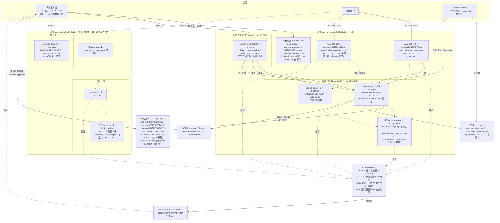
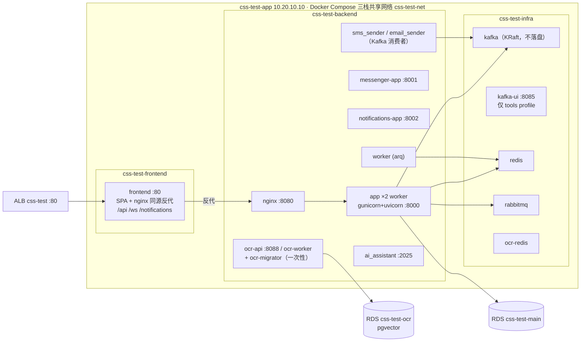
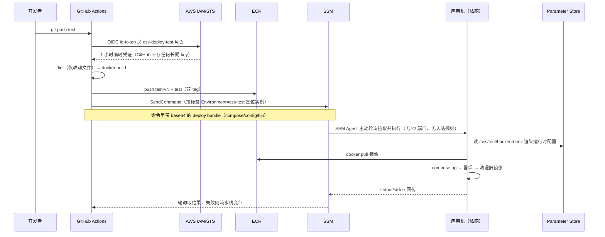
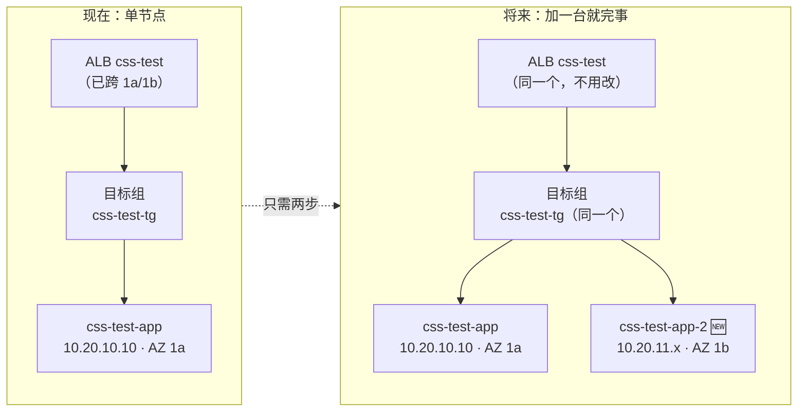

# CSS 新账号（582797602427 / us-east-1）架构图 + 服务清单 + 成本

> 2026-07-28 编写、**2026-07-31 更新**（Terraform 全量纳管、应用机重建、堡垒机改名、每环境 SG 拆分、
> 标签键切换 EnvironmentGroup/Environment、开发入口 ALB、uat 库建成、prod 堡垒机上线），
> 反映**当前真实状态**（✅=已建成、⏳=待建）。价格为 us-east-1 按需价 × 730 小时/月的估算，
> 不含数据传输与突发用量；实际以 Cost Explorer 为准。
> **资源清单/ID/操作方法以 `css-terraform/{CLAUDE.md,使用说明/}` 为准**；Terraform 与脚本分工见
> [../新aws账号/职责划分.md](../新aws账号/职责划分.md)；凭证见工作区 `运维访问速查.local.md`。

---

## 一、总体拓扑（两套 VPC 物理隔离）

**三条访问铁律**：① SSH 只经堡垒机；② 系统 Web 只经本环境 ALB（现用 ALB DNS；域名在 GoDaddy、不用 Route53，未来 ACM 手动 CNAME 验证，HTTPS 未开）；③ RDS 只能内网访问。
kafka-ui（无认证且能读 2FA 验证码）**不挂业务 ALB**（8085 已全部撤除），只走**开发入口 ALB** `css-non-prod-entry`（test `:8085` / uat `:8086`，白名单 `221.214.0.190/32` + `134.195.101.194/32`）。

**ALB**：业务 ALB 每环境一个，名字=环境名 `css-test` / `css-uat` / `css-prod`（原共享 `css-nonprod-alb` 已删，"uat 按 Host 分流"作废）；另有一个跨环境的**开发入口 ALB** `css-non-prod-entry`（仅 kafka-ui 等开发工具，白名单）。

**堡垒机（2026-07-30 改名）**：`css-non-prod-gw` → **`css-non-prod-bastion`**（实例 ID 与 EIP 不变；本机私钥文件名沿用 `css-non-prod-gw.pem`）。只做堡垒 SSH + NAT 两件事，入站两条规则：

| 规则 | 用途 | 能不能删 |
|------|------|----------|
| `22 ← 白名单 IP` | SSH 跳板（唯一管理入口） | 删了就上不去机器 |
| `10.20.0.0/16 全协议` | **NAT 回程**——私有子网的 test/uat 无公网 IP，出网全靠堡垒机 iptables 转发，回程流量必须放行 | **删了两台机器直接断网**（拉不了镜像、连不上 SSM）。它不是给 SSH 的 |

**非生产安全组已按环境拆分（2026-07-30，Terraform 纳管）**：旧共用的 `css-non-prod-app-sg`/`css-non-prod-alb-sg` 已删除，现每环境独立：

| 安全组 | ID | 用途 |
|--------|-----|------|
| `css-non-prod-bastion-sg`（旧 `css-non-prod-gw-sg` 已删） | `sg-0b0a1508e6063d23f` | 堡垒机：SSH 跳板 + NAT 回程 |
| `css-test-app-sg` / `css-test-alb-sg` | `sg-0ece87f7087c3b6d9` / `sg-090abd4ac21053904` | test 应用机 / test ALB |
| `css-uat-app-sg` / `css-uat-alb-sg` | `sg-0bf1d8adaf6e4a0e6` / `sg-0d02ba42b56aea851` | uat 应用机 / uat ALB |
| `css-non-prod-rds-sg` | `sg-0197c0db4578107ef` | RDS，仅内网 |
| `css-non-prod-entry-sg` | `sg-0dc5c5ed025c07a76` | 开发入口 ALB，白名单 |

应用机 SG 每环境两条入站：`22 ← 堡垒机 SG`、`80 ← 本环境 ALB SG`。
生产的 `css-prod-alb-sg` / `css-prod-app-sg` / `css-prod-bastion-sg` / `css-prod-rds-sg` ID 不变（见 [aws-css-prod.md](aws-css-prod.md)）。

---

## 二、单台应用机内部（test 现状，uat/prod 同构）

> Kafka 是**登录硬依赖**：auth 的依赖注入启动即连 `kafka:9092`，infra 栈没起来登录直接 500。

---

## 三、CI/CD 数据流（回答"SSH command 的数据从哪来"）

**关键点**：GitHub 侧不保存任何 AWS 密钥（OIDC）；命令不走 SSH，是机器上的 SSM Agent **主动出站**拉取执行的；
密钥类配置从不进 CI 日志——运行时值由机器自己从 Parameter Store 取。

---

## 四、服务清单与成本

### 4.0 实测校准（2026-07-31 Cost Explorer）

**实际账单约是下面理论估算的一半**：最新完整天 7-30 真实用量 **$4.54/天 ≈ $136/月**
（EC2 $80 / ALB $27 / IPv4 $16 / RDS $8 / EBS $4 / 其它 $2，折月口径），且被 credits 全额抵扣、账面净额 0。
原因是账号在 Free Plan、credits 抵扣 + 部分资源仍在免费额度内；**credits 耗尽后会趋向下表的裸奔价**。
明细与历史（含 7-29 被账单重述为 $7.23 的说明）见 [成本价格表.md](成本价格表.md) 开头的实测表。

### 4.1 已在计费（当前状态，test 可用 + uat 已建机）

| 服务 | 资源 | 规格 | 单价 | 月成本估算 |
|------|------|------|------|-----------|
| EC2 | `css-test-app` | m7i-flex.large（2C/8G） | ~$0.0945/h | **≈ $69** |
| EC2 | `css-uat-app` | m7i-flex.large（2C/8G） | ~$0.0945/h | **≈ $69**（不用时 stop 可省，只剩 EBS ~$4） |
| EC2 | `css-non-prod-bastion` | t4g.micro（堡垒 + NAT） | ~$0.0084/h | ≈ $6 |
| EC2 | `css-prod-bastion`（✅ 2026-07-31 已在跑） | t4g.micro + EIP | ~$0.0084/h | ≈ $10（含 IPv4） |
| EBS | 4 台 gp3 根卷 | 50+50+8+8 GB | $0.08/GB | ≈ $10 |
| RDS | `css-non-prod` | db.t4g.micro + 20GB gp3 | ~$0.016/h | ≈ $14 |
| ALB | `css-test` + `css-uat` + **开发入口 `css-non-prod-entry`** | **3 个** + 少量 LCU | $0.0225/h + LCU | **≈ $60**（各 ≈ $20） |
| 公网 IPv4 | EIP 2 个 + 3 个 ALB × 2 AZ 节点 IP = 8 个 | — | $0.005/h/个 | ≈ $29 |
| ECR | 21 仓库 × ≤5 镜像 | 约 15–25 GB | $0.10/GB | ≈ $2 |
| Secrets Manager | RDS 托管密码 1 条 | — | $0.40/条 | $0.4 |
| Parameter Store | `/css/test/backend.env`（Advanced） | 1 条 Advanced + 若干 Standard | $0.05/条 | $0.1 |
| S3 | `css-test-582797602427`、`css-uat-582797602427`、`css-prod-582797602427` + `css-dbsync-582797602427` | 现约 60 MB，开版本控制 | $0.023/GB | ≈ $2 |
| S3 | **`css-dev-582797602427`**（本地开发直传真实 S3，替代 localhost:9000 的 MinIO） | 量极小 | $0.023/GB | ≈ $0 |
| **CloudWatch 告警** | `css-test` + `css-uat` 各 9 条告警 + 1 Dashboard + 1 SNS 主题 | 告警 9×2=18 条 | $0.10/告警/月 | **≈ $2** |
| SSM / IAM / VPC / CloudWatch 基础指标 | — | — | 免费额度内 | $0 |
| | | | **小计** | **≈ $272/月**（uat 应用机常关则 ≈ $203） |

> 2026-07-31 相比 07-29 版 +$40：开发入口 ALB `css-non-prod-entry`（+$20 + 2 个节点 IPv4 +$7）、
> prod 堡垒机上线（+$10）。ALB 不能"停机"，uat 停机只省应用机的 $69（EBS 仍 ~$4，`css-uat` ALB 仍照收）。
> 监控由 css-terraform `monitoring` stack 管理，SNS 告警已订阅两个邮箱（确认状态待核实）。
> 历史减法（2026-07-29）：旧 S3 桶 `css-test-storage-582797602427` 已退役、空置默认 VPC 已删除。

### 4.1.1 按环境拆分口径

上表 ≈$272 是当前全账号在跑资源的打包数（含开发入口 ALB 与 prod 堡垒机）。拆到单环境（非生产共享资源含开发入口 ALB，test/uat 各摊一半）：
**test ≈ $132/月、uat ≈ $132/月**（uat 停机时 ≈ $63）、**prod 上线后 ≈ $361/月**（独占一套 VPC/RDS/NAT，无均摊；含已在跑的堡垒机 ~$10）、
dev ≈ $0（仅 S3 桶）。逐项明细见 [成本价格表.md](成本价格表.md)「按环境拆分」。

### 4.2 生产环境规划（堡垒机已建；其余 `enable_prod_compute` 门控，需 Paid plan）

| 服务 | 规格 | 月成本估算 | 说明 |
|------|------|-----------|------|
| EC2 `css-prod-app` | **c5.xlarge（4C/8G）** | $125 | ⏳ 门控；规格为 css-terraform `prod/ec2` stack 默认值，后期可停机调整 |
| EC2 `css-prod-bastion` | t4g.micro，**常驻运行**（7×24，不做自动停机） | $6 | ✅ **已建在跑**（`i-0a6d6754c61c239d0`，EIP `34.225.237.45`）；纯跳板，生产唯一 SSH 入口 |
| NAT 网关 | **托管**（非自建） | $33 + 流量 | ⏳ 门控；生产不用堡垒机自建 NAT：自建是单点，生产稳定性优先 |
| RDS `css-prod` | db.t4g.medium **Multi-AZ** + 100GB | $120 | ⏳ 门控；备份 7 天 + 删除保护；Multi-AZ 即生产的数据库高可用手段 |
| ALB `css-prod` | 1 个（名字=环境名） | $20 | ⏳ 门控；ACM 证书免费（GoDaddy 域名走手动 CNAME 验证） |
| **CloudWatch 监控** | 9 条告警 + Dashboard + SNS | $1 | ⏳ 门控（css-terraform `prod/monitoring` stack） |
| EBS + IPv4 + ECR 等 | — | $20 | |
| | **小计** | **≈ $325/月** | 日志收集另计（prod ≈ $5.3/月） |

### 4.3 阻塞项

- ⚠️ **css-prod RDS 建不出来**：Free plan 拦截（`FreeTierRestrictionError`，7 天备份保留不被允许）→ 需先升 Paid plan（升级后开 `enable_prod_compute` 门控）。
- ⚠️ **非生产 RDS 升配 db.t4g.micro → db.t4g.small 也被 Free plan 拦截**：AWS 直接返回
  `FreeTierRestrictionError: This instance size isn't available with free plan accounts`——**Free plan 下 RDS 只能 db.t4g.micro**。
  升配的动机是内存不是 CPU：实测 CPU 平均 3.6% / 峰值 29.7%（远非瓶颈），**可用内存平均只剩 146MB** 才是真瓶颈，
  small 把内存 1G→2G 正对症。升 Paid plan 后改 css-terraform `css-non-prod/database` stack 的实例规格变量 apply（单 AZ 会重启 2–5 分钟），+$12/月。
- 免费层可用的 EC2 实例类型实测只有：`m7i-flex.large`、`c7i-flex.large`、`t3.micro/small`、`t4g.micro/small`（`t4g.nano`、`t3.large` 不可用）。

---

## 五、AZ 与扩容规划（2026-07-29 实查）

**结论先行：现在是"单节点运行、多 AZ 就绪"——将来加节点不需要动网络结构。**

### 5.1 AZ 现状（实查，非规划）

| 层 | 现状 | 跨几个 AZ |
|----|------|-----------|
| VPC `css-non-prod` 子网 | 公有 10.20.0.0/24（1a）+ 10.20.1.0/24（1b）；私有 10.20.10.0/24（1a）+ 10.20.11.0/24（1b） | **2**（us-east-1a / 1b） |
| VPC `css-prod` 子网 | 同构（公有/私有各 2 个，分列 1a / 1b） | **2** |
| ALB `css-test` / `css-uat` | 各自都绑了两个公有子网 | **2** |
| RDS 子网组 | 覆盖两个私有子网 | **2** |
| **应用机** | test 在 **1a**（10.20.10.10）、uat 在 **1b**（10.20.11.10） | **各 1 台**（符合"当前 1 个节点即可"） |

> 为什么"子网跨 2 AZ、机器只放 1 台"是对的：ALB 本身**必须**至少绑 2 个 AZ 的子网才能创建，RDS 子网组同理；
> 这些是一次性的网络结构，建的时候就按最终形态铺好，成本为零（子网/路由表不收费）。
> 真正花钱的是 EC2 实例——所以实例先按需要的**数量**放，不为"以后可能扩容"提前买机器。

### 5.2 将来怎么加节点（不改网络）

扩容动作只有两步：① 在**另一个 AZ 的私有子网**建第二台机器（css-terraform `ec2` stack 加实例）；
② 把它 `register-targets` 进**同一个目标组**。ALB 随即自动在两个 AZ 之间做负载均衡与故障剔除，
**VPC、子网、路由表、安全组、NAT、RDS 一律不用改**。

⚠️ 加节点前要先解决的三件有状态的事（现在都是"单机内自托管"）：

| 组件 | 现状 | 多节点时怎么办 |
|------|------|----------------|
| redis / rabbitmq / kafka（infra 栈） | 每台机器各跑一份，**互不相通** | 抽成共享服务（ElastiCache / Amazon MQ / MSK），或指定一台为主、另一台连过来 |
| arq worker + cron 任务 | 单实例，任务不会重复 | 多节点会**重复执行 cron**——必须只在一个节点跑 worker，或引入分布式锁 |
| WebSocket（messenger） | 单机内存持有连接 | ALB 需开 stickiness，或让 messenger 走 redis pub/sub 广播 |

数据库侧的高可用不是"加节点"，而是 **RDS 开 Multi-AZ**（生产规划里已经是 Multi-AZ；非生产单 AZ 省钱）。

---

## 六、三环境对照

| 维度 | test ✅ | uat ✅建机/⏳部署 | prod ⏳ |
|------|---------|------------------|---------|
| VPC | css-non-prod 10.20.0.0/16 | 同左（共用） | css-prod 10.10.0.0/16（隔离） |
| 应用机 | 10.20.10.10 m7i-flex.large | 10.20.11.10 m7i-flex.large | 10.10.10.10（规格待定） |
| 数据库 | RDS css-non-prod 的 `css-test-main`/`-ocr`（**已脱敏**，应用账号 `css_app_test`） | 同实例 `css-uat-main`/`-ocr` ✅ **已建**（=test 数据，账号 `css_app_uat`） | 独立实例 css-prod，Multi-AZ ⏳ |
| 入口 | **ALB `css-test`** `css-test-524317374.us-east-1.elb.amazonaws.com` | **ALB `css-uat`** `css-uat-1366981991.us-east-1.elb.amazonaws.com` | **ALB `css-prod`** ⏳（等应用机） |
| AZ | 应用机在 **us-east-1a**（子网已跨 1a/1b） | 应用机在 **us-east-1b**（同上） | 子网已跨 1a/1b，机器待建 |
| S3 桶 | `css-test-582797602427` ✅（旧桶 `css-test-storage-*` 已退役） | `css-uat-582797602427` ✅ | `css-prod-582797602427` ✅（空） |
| S3 访问身份 | IAM 用户 `css-app-test`（策略只限本桶，未生成 key） | `css-app-uat`（同上） | `css-app-prod`（同上） |
| **监控** | ✅ 9 条告警 + Dashboard `css-test` + SNS `css-test-alarms`（已订阅两邮箱，确认待核实） | ✅ 同左（`css-uat*`）；未部署时 `alb-no-healthy-target` 常态 ALARM 属正常 | ⏳ `enable_prod_compute` 门控（`prod/monitoring` stack） |
| 日志 | ⏳ 仍是容器本地 json-file（50m×3 轮转；日志组已建，采集未接入） | ⏳ 同左 | ⏳ 同左 |
| 堡垒 | css-non-prod-bastion（共用，原名 css-non-prod-gw） | 同左 | css-prod-bastion ✅（**常驻，不停机**） |
| 出网 | 堡垒机自建 NAT（省钱） | 同左 | 托管 NAT 网关（稳定，⏳ 门控） |
| 触发 | push `test` 分支 | push `uat` 分支 | push `main` 只构建，**部署需手动** Run workflow |
| 迁移前快照 | 不做（数据可弃） | 自动 | 自动 + alembic 核对 |
| IAM 角色 | css-deploy-test / css-ec2-test | …-uat | …-prod |
| ECR | `test/css-*` | `uat/css-*` | `prod/css-*` |
| 镜像 tag | `test-vN` + `test` | `uat-vN` + `uat` | `prod-vN` + `prod` |
| **月成本** | **≈ $132**（直接 ~$102 + 共享均摊 ~$30） | **≈ $132**（同左；停机时 ≈ $63） | **≈ $361**（独占，无均摊；上线后，含已在跑的堡垒机） |

> **成本口径**：test/uat 的"共享均摊"指堡垒机（堡垒+NAT）、其 EIP/EBS、RDS `css-non-prod` 实例、Secrets Manager、
> dbsync 中转桶、**开发入口 ALB `css-non-prod-entry`（含节点 IPv4，~$27）**与流量杂项（合计 ~$59/月）按 50/50 分摊；
> 应用机、ALB、ALB 节点 IPv4、EBS、监控、S3 桶为环境专属直接归属。
> 逐项拆分表见 [成本价格表.md](成本价格表.md)「按环境拆分」一节。dev（本地开发）在 AWS 上仅一个 S3 桶，≈ $0/月。

### 还有第四个"环境"：dev（本地开发）

**dev 不是 AWS 环境**，它跑在开发者自己的机器上（`deploy/windows/本地dev.ps1` + 本地 Postgres/kafka 容器）。
它在 AWS 上**只有两样东西**、没有任何计算资源：

| 项 | 值 | 说明 |
|----|----|------|
| S3 桶 | `css-dev-582797602427` ✅（已入 TF） | 标签 `EnvironmentGroup=css-non-prod` / `Environment=css-dev`；让本地开发直传真实 S3，取代原先 localhost:9000 的 MinIO（MinIO 与真实 S3 的行为差异会掩盖上线后才暴露的问题） |
| IAM 用户 | `css-app-dev` + 内联策略 `css-app-dev-s3` ✅ | **只能访问自己那个桶**；已生成 access key 并写入 `deploy-env/dev/backend.env` |
| EC2 / RDS / ALB / ECR | **无** | 数据库、kafka、redis 全在本机容器里 |

✅ 隔离已实测：dev 桶的上传 / 列举 / 下载 / 删除全部通过；用同一把 key 访问 `css-test-*` 与 `css-prod-*` 均被拒绝。
同款策略也已挂给 `css-app-test` / `css-app-uat` / `css-app-prod`（**故意不生成 key**，避免闲置长期凭证；
到要用时再 `07-获取应用iam密钥/issue-app-s3-key.sh <env> --new-key`）。

---

## 七、S3 存储桶（2026-07-31）

应用上传的发票/目录/图片走 S3，后端读 `S3_STORAGE_BUCKET_NAME`。**一环境一个桶，互不可见**；
桶由 css-terraform 各环境 `s3` stack 管理（dev 桶也已入 TF），细节见其 `使用说明/08-对象存储S3.md`。
⚠️ **临时债（2026-07）**：test/uat/prod 三桶已开**对象公有读**，改 presigned URL 方案后回收。

| 环境 | 桶名 | 说明 |
|------|------|------|
| test | `css-test-582797602427` ✅ | 纯名 `css-test` 被**别的 AWS 账号**占用（S3 桶名全球唯一，不分账号），回退带账号后缀；旧桶 `css-test-storage-582797602427` 的 **102 个对象已 `s3 sync` 迁入**，env 的 `S3_STORAGE_BUCKET_NAME` 已更新并灌进 Parameter Store；**旧桶已于 2026-07-29 退役**（`13-s3/retire-bucket.sh`，退役前做了逐对象内容指纹比对） |
| uat | `css-uat-582797602427` ✅ | 2026-07-29 由纯名 `css-uat` 改名重建（空桶无数据），统一成"带账号后缀"一种写法 |
| prod | `css-prod-582797602427` ✅ | 同 test，纯名被占 |
| **dev** | **`css-dev-582797602427`** ✅ | 2026-07-29 新增，供本地开发直传真实 S3（取代 localhost:9000 的 MinIO）；标签 `Environment=css-dev`，已入 TF |
| 运维 | `css-dbsync-582797602427` | 数据库 dump 中转（`05-数据库运维/restore-dump-via-gw.sh`），未纳管（归属待拍板） |

每个桶都配了：SSE-S3 默认加密 + 版本控制 + 生命周期（分段上传 7 天、历史版本 30 天）+ 双标签 + 最小 CORS。
原"阻断一切公共访问"在 test/uat/prod 三桶上**暂时放开为对象公有读**（见上方临时债说明），presigned 落地后恢复。

**访问主体一桶一用户**：后端代码要求显式 AK/SK（用不了实例角色），所以每个桶配一个 IAM 用户
`css-app-<env>` + 内联策略 `css-app-<env>-s3`，权限只覆盖本桶：桶级 `ListBucket` / `GetBucketLocation` /
`ListBucketMultipartUploads`，对象级 `PutObject` / `GetObject` / `DeleteObject` / `AbortMultipartUpload` /
`ListMultipartUploadParts`。脚本 `07-获取应用iam密钥/issue-app-s3-key.sh <env> [--new-key]`。
目前**只有 `css-app-dev` 生成了 key**（写进 `deploy-env/dev/backend.env`），test/uat/prod 三个用户策略已挂但刻意不发 key。

---

## 八、标签规范（2026-07-30 切换为新键，旧 `Group`/`CssEnv` 已彻底删除）

**所有资源都必须带**（由 Terraform provider default_tags 统一落）：

| 标签 | 取值 | 含义 |
|------|------|------|
| `EnvironmentGroup` | `css-non-prod` \| `css-prod` | 成本 / 权限分组（**只有这两个取值**） |
| `Environment` | `css-test` \| `css-uat` \| `css-prod` | **环境专属**资源 |
| `Environment` | `css-dev` | 本地开发专用（S3 桶 `css-dev-582797602427`） |
| `Environment` | 共享值 | **跨环境共享**资源（VPC、子网、堡垒机、非生产 RDS 等）不打任何 `css-<env>` 环境值 |
| `ManagedBy` | `terraform` | 由 css-terraform 纳管 |

> ⚠️ **共享资源为什么不能打 `css-<env>`**：IAM 的 `ssm:SendCommand` 条件、CI 与
> `09-ssm-run-command/` 脚本都是按 **`Environment=css-<env>`** 定位部署目标机的。给堡垒机（或 VPC/安全组）
> 打上 `css-test`，它就会被 test 的部署命令选中 → 往错误的机器上发部署。

- 成本分摊标签激活：`docs/新aws账号/activate-cost-tags.sh`（Cost Allocation Tags 按 `EnvironmentGroup`/`Environment` 出账）。
- 标签细节以 css-terraform `CLAUDE.md` 为准。

---

## 九、成本优化手段（按性价比排序）

1. **uat 应用机不用时 stop**：省 $69/月，EBS 仍收 ~$4（`css-uat` ALB 停不了，仍照收 ~$20）；开机后跑一次 `deploy-env.sh uat` 即可恢复。
2. 非生产用**堡垒机自建 NAT**（已采用）而非托管 NAT 网关：省 $33/月。
3. ECR lifecycle 只保留 5 个镜像（已配）：控制存储费。
4. 生产上线后再买 **Savings Plan / RI**：EC2 与 RDS 可省 30–40%。
5. test/uat 共用一个 RDS 实例（已采用）：省一份固定费。**ALB 不再共用**——2026-07-29 改为每环境一个（`css-test`/`css-uat`），换来环境隔离与免域名即可独立访问，代价 +$20/月。
