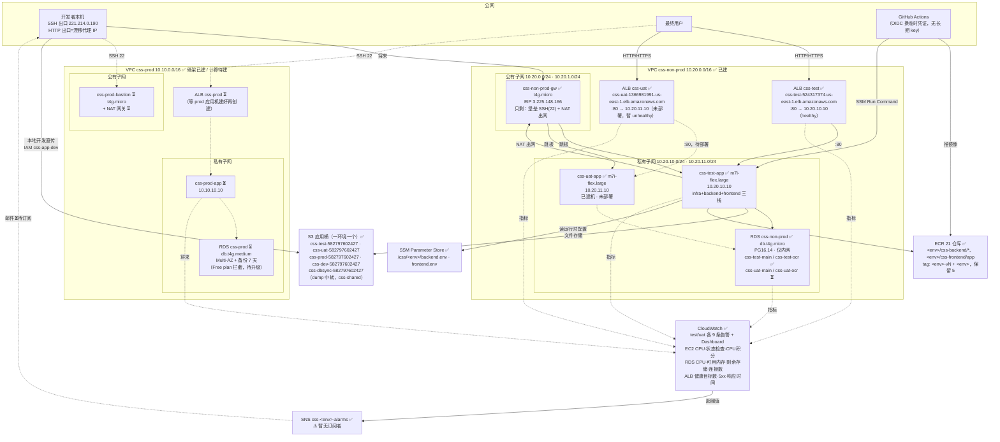
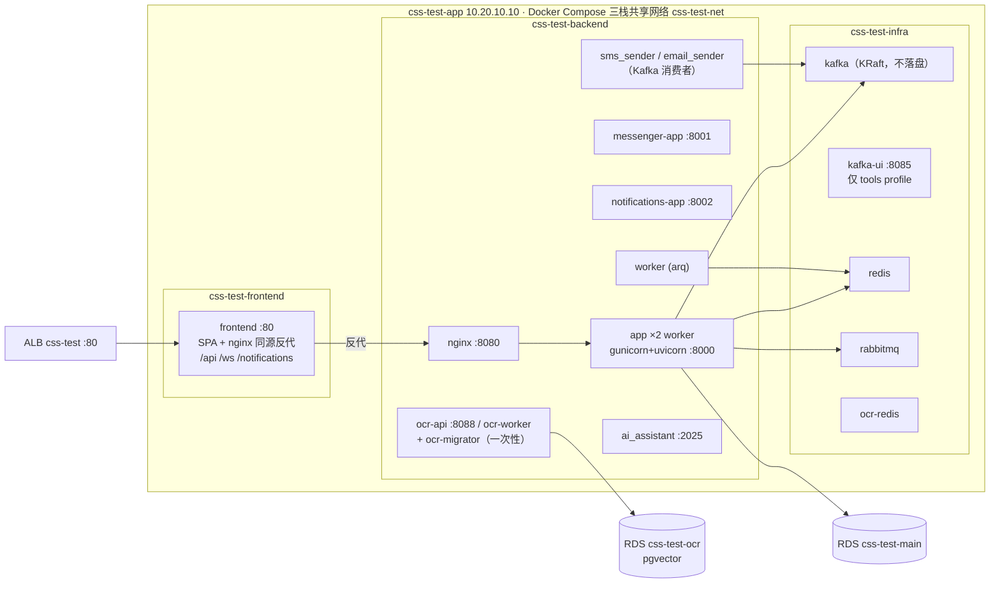
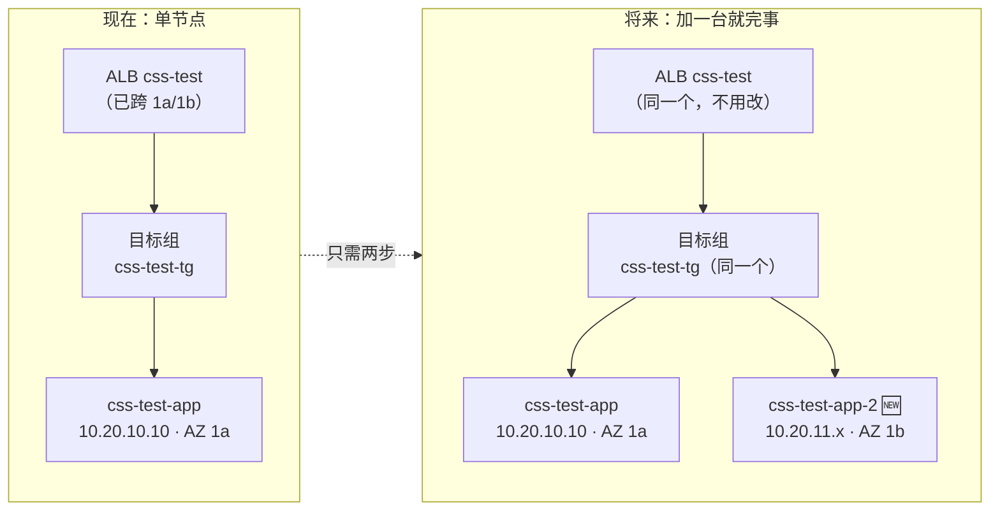

# CSS 新账号（582797602427 / us-east-1）架构图 + 服务清单 + 成本

> 2026-07-28 编写、**2026-07-29 更新**（每环境独立 ALB、标签规范落地、S3 桶、网关机过渡通道收口、
> CloudWatch 监控上线、dev 开发桶、默认 VPC 与旧桶退役、AZ 与扩容规划），
> 反映**当前真实状态**（✅=已建成、⏳=待建）。价格为 us-east-1 按需价 × 730 小时/月的估算，
> 不含数据传输与突发用量；实际以 Cost Explorer 为准。

---

## 一、总体拓扑（两套 VPC 物理隔离）

**三条访问铁律**：① SSH 只经堡垒机；② 系统 Web 只经本环境 ALB（现用 ALB DNS，绑域名 + ACM 后走 HTTPS 域名）；③ RDS 只能内网访问。
kafka-ui（8085）因无认证且能读 2FA 验证码，**不挂 ALB**，只走堡垒机 SSH 隧道。

**ALB 每环境一个（2026-07-29 拍板）**：名字就是环境名 `css-test` / `css-uat` / `css-prod`。
原共享的 `css-nonprod-alb` 已删除，"uat 按 Host 头分流"的设计随之作废——那是共享 ALB 时代的方案。

**网关机过渡通道已收口（2026-07-29）**：ALB 接管 Web 后，`gw-sg` 的 80/8080 入站、`app-sg` 的"来自网关的 80"
均已撤销，网关机 nginx 已停用并禁用（`12-alb/revoke-gw-proxy.sh`）。网关机现在只剩两条入站规则：

| 规则 | 用途 | 能不能删 |
|------|------|----------|
| `22 ← 221.214.0.190/32` | SSH 跳板（唯一管理入口） | 删了就上不去机器 |
| `10.20.0.0/16 全协议` | **NAT 回程**——私有子网的 test/uat 无公网 IP，出网全靠网关机 iptables 转发，回程流量必须放行 | **删了两台机器直接断网**（拉不了镜像、连不上 SSM）。它不是给 SSH 的 |

应用机 SG 现在只有两条：`22 ← 网关机 SG`、`80 ← ALB SG`。

**非生产安全组已统一改名（2026-07-29）**：`css-nonprod-*` → **`css-non-prod-*`**，与 VPC / RDS / `Group` 标签写法一致。
AWS 的 GroupName 创建后不可改，所以是"新建 → 双挂 → 金丝雀 → 切换 → 删旧"的零中断迁移
（`docs/新aws账号/01-vpc/rename-security-groups.sh`），旧 4 个已删除：

| 安全组 | ID | 用途 |
|--------|-----|------|
| `css-non-prod-gw-sg` | `sg-0f449992d538ac3b4` | 网关机：SSH 跳板 + NAT 回程 |
| `css-non-prod-alb-sg` | `sg-0c7b0b571d74b1f2f` | 两个非生产 ALB 共用，80/443 公网 |
| `css-non-prod-app-sg` | `sg-0d06e029924989ee3` | test/uat 应用机 |
| `css-non-prod-rds-sg` | `sg-0197c0db4578107ef` | RDS，仅内网 |

生产的 `css-prod-alb-sg` / `css-prod-app-sg` / `css-prod-bastion-sg` / `css-prod-rds-sg` 本就合规，未参与迁移，ID 不变。

---

## 二、单台应用机内部（test 现状，uat/prod 同构）

> Kafka 是**登录硬依赖**：auth 的依赖注入启动即连 `kafka:9092`，infra 栈没起来登录直接 500。

---

## 三、CI/CD 数据流（回答"SSH command 的数据从哪来"）

**关键点**：GitHub 侧不保存任何 AWS 密钥（OIDC）；命令不走 SSH，是机器上的 SSM Agent **主动出站**拉取执行的；
密钥类配置从不进 CI 日志——运行时值由机器自己从 Parameter Store 取。

---

## 四、服务清单与成本

### 4.0 实测校准（2026-07-30 Cost Explorer）

**实际账单是下面理论估算的 43%**：7-29 真实用量 **$3.40/天 ≈ $102/月**
（EC2 $66 / ALB $18 / IPv4 $8 / RDS $7 / EBS $3 / 其它 $1），且被 credits 全额抵扣、账面净额 0。
原因是账号在 Free Plan、credits 抵扣 + 部分资源仍在免费额度内；**credits 耗尽后会趋向下表的裸奔价**。
明细见 [成本价格表.md](成本价格表.md) 开头的实测表。

### 4.1 已在计费（当前状态，test 可用 + uat 已建机）

| 服务 | 资源 | 规格 | 单价 | 月成本估算 |
|------|------|------|------|-----------|
| EC2 | `css-test-app` | m7i-flex.large（2C/8G） | ~$0.0945/h | **≈ $69** |
| EC2 | `css-uat-app` | m7i-flex.large（2C/8G） | ~$0.0945/h | **≈ $69**（不用时 stop 可省，只剩 EBS ~$4） |
| EC2 | `css-non-prod-gw` | t4g.micro（堡垒 + NAT） | ~$0.0084/h | ≈ $6 |
| EBS | 3 台 gp3 根卷 | 50+50+8 GB | $0.08/GB | ≈ $9 |
| RDS | `css-non-prod` | db.t4g.micro + 20GB gp3 | ~$0.016/h | ≈ $14 |
| ALB | `css-test` + `css-uat` | **2 个**（每环境一个）+ 少量 LCU | $0.0225/h + LCU | **≈ $40**（各 ≈ $20） |
| 公网 IPv4 | EIP 1 个 + 2 个 ALB × 2 AZ 节点 IP = 5 个 | — | $0.005/h/个 | ≈ $18 |
| ECR | 21 仓库 × ≤5 镜像 | 约 15–25 GB | $0.10/GB | ≈ $2 |
| Secrets Manager | RDS 托管密码 1 条 | — | $0.40/条 | $0.4 |
| Parameter Store | `/css/test/backend.env`（Advanced） | 1 条 Advanced + 若干 Standard | $0.05/条 | $0.1 |
| S3 | `css-test-582797602427`、`css-uat-582797602427`、`css-prod-582797602427` + `css-dbsync-582797602427` | 现约 60 MB，开版本控制 | $0.023/GB | ≈ $2 |
| S3 | **`css-dev-582797602427`**（本地开发直传真实 S3，替代 localhost:9000 的 MinIO） | 量极小 | $0.023/GB | ≈ $0 |
| **CloudWatch 告警** | `css-test` + `css-uat` 各 9 条告警 + 1 Dashboard + 1 SNS 主题 | 告警 9×2=18 条 | $0.10/告警/月 | **≈ $2** |
| SSM / IAM / VPC / CloudWatch 基础指标 | — | — | 免费额度内 | $0 |
| | | | **小计** | **≈ $232/月**（uat 应用机常关则 ≈ $163） |

> 2026-07-29 相比上版 +$32：ALB 由共享 1 个改为每环境 1 个（+$20），随之多 2 个 ALB 节点公网 IPv4（+$11），S3 +$1。
> ALB 不能"停机"，uat 停机只省应用机的 $69（EBS 仍 ~$4，`css-uat` ALB 仍照收）。
> 2026-07-29 晚再 +$2：CloudWatch 监控告警（脚本 `14-cloudwatch/create-monitoring.sh`，详见
> [14-cloudwatch/README.md](../新aws账号/14-cloudwatch/README.md)）。Dashboard 前 3 个免费、SNS 前 1000 封邮件免费，
> 所以这 $2 基本等于 18 条告警的钱。⚠️ **SNS 主题还没有订阅者，告警响了没人收得到**，等邮箱补上。
> 同期两笔减法：旧 S3 桶 `css-test-storage-582797602427` 已退役（102 个对象逐对象内容指纹比对确认已迁入新桶）、
> 账号自带的空置默认 VPC `vpc-0f1a28d652c598172` 已删除（含 6 子网 / IGW / RDS default 子网组）。

### 4.1.1 按环境拆分口径

上表 ≈$232 是 css-non-prod 分组的打包数。拆到单环境（共享资源 test/uat 各摊一半）：
**test ≈ $118/月、uat ≈ $118/月**（uat 停机时 ≈ $49）、**prod 上线后 ≈ $358/月**（独占一套 VPC/RDS/NAT，无均摊）、
dev ≈ $0（仅 S3 桶）。逐项明细见 [成本价格表.md](成本价格表.md)「按环境拆分」。

### 4.2 生产环境规划（尚未创建，需 Paid plan）

| 服务 | 规格 | 月成本估算 | 说明 |
|------|------|-----------|------|
| EC2 `css-prod-app` | **c5.xlarge（4C/8G）** | $125 | ✅ 规格已确认：`06-ec2/create-app-ec2.sh prod` **默认即 c5.xlarge**，无需额外指定；后期可停机调整 |
| EC2 `css-prod-bastion` | t4g.micro，**常驻运行**（7×24，不做自动停机） | $6 | 纯跳板，同时是生产唯一 SSH 入口——停机等于把自己锁在门外 |
| NAT 网关 | **托管**（非自建） | $33 + 流量 | 生产不用网关机自建 NAT：自建是单点、要自己维护 iptables 与转发，生产稳定性优先 |
| RDS `css-prod` | db.t4g.medium **Multi-AZ** + 100GB | $120 | 备份 7 天 + 删除保护；Multi-AZ 即生产的数据库高可用手段 |
| ALB `css-prod` | 1 个（名字=环境名） | $20 | ACM 证书免费；等 prod 应用机建好后 `12-alb/create-alb.sh prod` |
| **CloudWatch 监控** | 9 条告警 + Dashboard + SNS | $1 | `14-cloudwatch/create-monitoring.sh prod`；加 `--with-agent` 收内存/磁盘则 ~$1.5 |
| EBS + IPv4 + ECR 等 | — | $20 | |
| | **小计** | **≈ $325/月** | 日志收集另计（prod ≈ $5.3/月，见 14-cloudwatch 方案） |

### 4.3 阻塞项

- ⚠️ **css-prod RDS 建不出来**：Free plan 拦截（`FreeTierRestrictionError`，7 天备份保留不被允许）→ 需先升 Paid plan。
- ⚠️ **非生产 RDS 升配 db.t4g.micro → db.t4g.small 也被 Free plan 拦截**：AWS 直接返回
  `FreeTierRestrictionError: This instance size isn't available with free plan accounts`——**Free plan 下 RDS 只能 db.t4g.micro**。
  升配的动机是内存不是 CPU：实测 CPU 平均 3.6% / 峰值 29.7%（远非瓶颈），**可用内存平均只剩 146MB** 才是真瓶颈，
  small 把内存 1G→2G 正对症。脚本 `04-rds/resize-rds.sh` 已就绪，升 Paid plan 后
  `./resize-rds.sh css-non-prod db.t4g.small --now` 一条命令（单 AZ 会重启 2–5 分钟），+$12/月。
- ⚠️ **CloudWatch 告警没有收件人**：`css-test-alarms` / `css-uat-alarms` 两个 SNS 主题目前零订阅者，
  告警会变红但不会通知任何人。给邮箱后 `create-monitoring.sh <env> <邮箱>` 重跑即可（需点确认邮件里的链接）。
- 免费层可用的 EC2 实例类型实测只有：`m7i-flex.large`、`c7i-flex.large`、`t3.micro/small`、`t4g.micro/small`（`t4g.nano`、`t3.large` 不可用）。

---

## 五、AZ 与扩容规划（2026-07-29 实查）

**结论先行：现在是"单节点运行、多 AZ 就绪"——将来加节点不需要动网络结构。**

### 5.1 AZ 现状（实查，非规划）

| 层 | 现状 | 跨几个 AZ |
|----|------|-----------|
| VPC `css-non-prod` 子网 | 公有 10.20.0.0/24（1a）+ 10.20.1.0/24（1b）；私有 10.20.10.0/24（1a）+ 10.20.11.0/24（1b） | **2**（us-east-1a / 1b） |
| VPC `css-prod` 子网 | 同构（公有/私有各 2 个，分列 1a / 1b） | **2** |
| ALB `css-test` / `css-uat` | 各自都绑了两个公有子网 | **2** |
| RDS 子网组 | 覆盖两个私有子网 | **2** |
| **应用机** | test 在 **1a**（10.20.10.10）、uat 在 **1b**（10.20.11.10） | **各 1 台**（符合"当前 1 个节点即可"） |

> 为什么"子网跨 2 AZ、机器只放 1 台"是对的：ALB 本身**必须**至少绑 2 个 AZ 的子网才能创建，RDS 子网组同理；
> 这些是一次性的网络结构，建的时候就按最终形态铺好，成本为零（子网/路由表不收费）。
> 真正花钱的是 EC2 实例——所以实例先按需要的**数量**放，不为"以后可能扩容"提前买机器。

### 5.2 将来怎么加节点（不改网络）

扩容动作只有两步：① 在**另一个 AZ 的私有子网**建第二台机器（`06-ec2/create-app-ec2.sh` 同款）；
② 把它 `register-targets` 进**同一个目标组**。ALB 随即自动在两个 AZ 之间做负载均衡与故障剔除，
**VPC、子网、路由表、安全组、NAT、RDS 一律不用改**。

⚠️ 加节点前要先解决的三件有状态的事（现在都是"单机内自托管"）：

| 组件 | 现状 | 多节点时怎么办 |
|------|------|----------------|
| redis / rabbitmq / kafka（infra 栈） | 每台机器各跑一份，**互不相通** | 抽成共享服务（ElastiCache / Amazon MQ / MSK），或指定一台为主、另一台连过来 |
| arq worker + cron 任务 | 单实例，任务不会重复 | 多节点会**重复执行 cron**——必须只在一个节点跑 worker，或引入分布式锁 |
| WebSocket（messenger） | 单机内存持有连接 | ALB 需开 stickiness，或让 messenger 走 redis pub/sub 广播 |

数据库侧的高可用不是"加节点"，而是 **RDS 开 Multi-AZ**（生产规划里已经是 Multi-AZ；非生产单 AZ 省钱）。

---

## 六、三环境对照

| 维度 | test ✅ | uat ✅建机/⏳部署 | prod ⏳ |
|------|---------|------------------|---------|
| VPC | css-non-prod 10.20.0.0/16 | 同左（共用） | css-prod 10.10.0.0/16（隔离） |
| 应用机 | 10.20.10.10 m7i-flex.large | 10.20.11.10 m7i-flex.large | 10.10.10.10（规格待定） |
| 数据库 | RDS css-non-prod 的 `css-test-main`/`-ocr`（**已脱敏**） | 同实例 `css-uat-main`/`-ocr`（待建库） | 独立实例 css-prod，Multi-AZ |
| 入口 | **ALB `css-test`** `css-test-524317374.us-east-1.elb.amazonaws.com` | **ALB `css-uat`** `css-uat-1366981991.us-east-1.elb.amazonaws.com` | **ALB `css-prod`** ⏳（等应用机） |
| AZ | 应用机在 **us-east-1a**（子网已跨 1a/1b） | 应用机在 **us-east-1b**（同上） | 子网已跨 1a/1b，机器待建 |
| S3 桶 | `css-test-582797602427` ✅（旧桶 `css-test-storage-*` 已退役） | `css-uat-582797602427` ✅ | `css-prod-582797602427` ✅（空） |
| S3 访问身份 | IAM 用户 `css-app-test`（策略只限本桶，未生成 key） | `css-app-uat`（同上） | `css-app-prod`（同上） |
| **监控** | ✅ 9 条告警 + Dashboard `css-test` + SNS `css-test-alarms`（⚠️ 无订阅者） | ✅ 同左（`css-uat*`）；未部署时 `alb-no-healthy-target` 常态 ALARM 属正常 | ⏳ 等应用机建好后 `create-monitoring.sh prod --with-agent` |
| 日志 | ⏳ 仍是容器本地 json-file（50m×3 轮转） | ⏳ 同左 | ⏳ 同左；方案见 14-cloudwatch |
| 堡垒 | css-non-prod-gw（共用） | 同左 | css-prod-bastion（**常驻，不停机**） |
| 出网 | 网关机 NAT（省钱） | 同左 | 托管 NAT 网关（稳定） |
| 触发 | push `test` 分支 | push `uat` 分支 | push `main` 只构建，**部署需手动** Run workflow |
| 迁移前快照 | 不做（数据可弃） | 自动 | 自动 + alembic 核对 |
| IAM 角色 | css-deploy-test / css-ec2-test | …-uat | …-prod |
| ECR | `test/css-*` | `uat/css-*` | `prod/css-*` |
| 镜像 tag | `test-vN` + `test` | `uat-vN` + `uat` | `prod-vN` + `prod` |
| **月成本** | **≈ $118**（直接 ~$102 + 共享均摊 ~$16） | **≈ $118**（同左；停机时 ≈ $49） | **≈ $358**（独占，无均摊；上线后） |

> **成本口径**：test/uat 的"共享均摊"指网关机（堡垒+NAT）、其 EIP/EBS、RDS `css-non-prod` 实例、Secrets Manager、
> dbsync 中转桶与流量杂项（合计 ~$32/月）按 50/50 分摊；应用机、ALB、ALB 节点 IPv4、EBS、监控、S3 桶为环境专属直接归属。
> 逐项拆分表见 [成本价格表.md](成本价格表.md)「按环境拆分」一节。dev（本地开发）在 AWS 上仅一个 S3 桶，≈ $0/月。

### 还有第四个"环境"：dev（本地开发）

**dev 不是 AWS 环境**，它跑在开发者自己的机器上（`deploy/windows/本地dev.ps1` + 本地 Postgres/kafka 容器）。
它在 AWS 上**只有两样东西**、没有任何计算资源：

| 项 | 值 | 说明 |
|----|----|------|
| S3 桶 | `css-dev-582797602427` ✅ | 标签 `Group=css-non-prod` / `CssEnv=css-dev`；让本地开发直传真实 S3，取代原先 localhost:9000 的 MinIO（MinIO 与真实 S3 的行为差异会掩盖上线后才暴露的问题） |
| IAM 用户 | `css-app-dev` + 内联策略 `css-app-dev-s3` ✅ | **只能访问自己那个桶**；已生成 access key 并写入 `deploy-env/dev/backend.env` |
| EC2 / RDS / ALB / ECR | **无** | 数据库、kafka、redis 全在本机容器里 |

✅ 隔离已实测：dev 桶的上传 / 列举 / 下载 / 删除全部通过；用同一把 key 访问 `css-test-*` 与 `css-prod-*` 均被拒绝。
同款策略也已挂给 `css-app-test` / `css-app-uat` / `css-app-prod`（**故意不生成 key**，避免闲置长期凭证；
到要用时再 `07-iam/create-app-s3-user.sh <env> --new-key`）。

---

## 七、S3 存储桶（2026-07-29）

应用上传的发票/目录/图片走 S3，后端读 `S3_STORAGE_BUCKET_NAME`。**一环境一个桶，互不可见**；
建桶脚本 `docs/新aws账号/13-s3/create-s3.sh`，细节见 [13-s3/README.md](../新aws账号/13-s3/README.md)。

| 环境 | 桶名 | 说明 |
|------|------|------|
| test | `css-test-582797602427` ✅ | 纯名 `css-test` 被**别的 AWS 账号**占用（S3 桶名全球唯一，不分账号），回退带账号后缀；旧桶 `css-test-storage-582797602427` 的 **102 个对象已 `s3 sync` 迁入**，env 的 `S3_STORAGE_BUCKET_NAME` 已更新并灌进 Parameter Store；**旧桶已于 2026-07-29 退役**（`13-s3/retire-bucket.sh`，退役前做了逐对象内容指纹比对） |
| uat | `css-uat-582797602427` ✅ | 2026-07-29 由纯名 `css-uat` 改名重建（空桶无数据），统一成"带账号后缀"一种写法 |
| prod | `css-prod-582797602427` ✅ | 同 test，纯名被占 |
| **dev** | **`css-dev-582797602427`** ✅ | 2026-07-29 新增，供本地开发直传真实 S3（取代 localhost:9000 的 MinIO）；标签 `CssEnv=css-dev` |
| 运维 | `css-dbsync-582797602427` | 数据库 dump 中转（`05-数据同步/restore-dump-via-gw.sh`），标签 `CssEnv=css-shared` |

每个桶都配了：阻断一切公共访问 + SSE-S3 默认加密 + 版本控制 + 生命周期（分段上传 7 天、历史版本 30 天）+ 双标签 + 最小 CORS。

**访问主体一桶一用户**：后端代码要求显式 AK/SK（用不了实例角色），所以每个桶配一个 IAM 用户
`css-app-<env>` + 内联策略 `css-app-<env>-s3`，权限只覆盖本桶：桶级 `ListBucket` / `GetBucketLocation` /
`ListBucketMultipartUploads`，对象级 `PutObject` / `GetObject` / `DeleteObject` / `AbortMultipartUpload` /
`ListMultipartUploadParts`。脚本 `07-iam/create-app-s3-user.sh <env> [--new-key]`。
目前**只有 `css-app-dev` 生成了 key**（写进 `deploy-env/dev/backend.env`），test/uat/prod 三个用户策略已挂但刻意不发 key。

---

## 八、标签规范（2026-07-29 落地）

**所有资源都必须带两个标签**：

| 标签 | 取值 | 含义 |
|------|------|------|
| `Group` | `css-non-prod` \| `css-prod` | 成本 / 权限分组（**只有这两个取值**） |
| `CssEnv` | `css-test` \| `css-uat` \| `css-prod` | **环境专属**资源 |
| `CssEnv` | `css-dev` | 本地开发专用（目前只有 S3 桶 `css-dev-582797602427`） |
| `CssEnv` | `css-shared` | **跨环境共享**资源：VPC、子网、路由表、IGW、S3 端点、安全组、网关机/堡垒机及其 EIP、非生产 RDS 实例与子网组、`css-dbsync` 中转桶 |

✅ **2026-07-29 实查：46 个资源 100% 覆盖双标签，零例外**。此前唯一的例外来源是账号自带的默认 VPC
（`vpc-0f1a28d652c598172` 及其 6 个子网、IGW、RDS default 子网组）——它完全空置，已用
`01-vpc/delete-default-vpc.sh`（带空置校验）删除；需要时 `aws ec2 create-default-vpc` 可重建。

> ⚠️ **共享资源为什么必须是 `css-shared`**：IAM 的 `ssm:SendCommand` 条件、`09-ssm-run-command/run.sh` 与
> `deploy-env.sh` 都是按 `CssEnv=css-<env>` **定位部署目标机**的。给网关机（或 VPC/安全组）打上 `css-test`，
> 它就会被 test 的部署命令选中 → 往错误的机器上发部署。`css-shared` 既满足"每个资源两个标签"，又不会被任何环境的部署逻辑命中。

- 批量补打：`docs/新aws账号/tag-all-resources.sh`（幂等，支持 `--dry-run`），2026-07-29 已执行。
- 新建资源不用补打：`01-vpc` / `04-rds` / `06-ec2`(gateway) / `12-alb` / `13-s3` / `14-cloudwatch` 的创建脚本都已内置双标签。

---

## 九、成本优化手段（按性价比排序）

1. **uat 应用机不用时 stop**：省 $69/月，EBS 仍收 ~$4（`css-uat` ALB 停不了，仍照收 ~$20）；开机后跑一次 `deploy-env.sh uat` 即可恢复。
2. 非生产用**网关机自建 NAT**（已采用）而非托管 NAT 网关：省 $33/月。
3. ECR lifecycle 只保留 5 个镜像（已配）：控制存储费。
4. 生产上线后再买 **Savings Plan / RI**：EC2 与 RDS 可省 30–40%。
5. test/uat 共用一个 RDS 实例（已采用）：省一份固定费。**ALB 不再共用**——2026-07-29 改为每环境一个（`css-test`/`css-uat`），换来环境隔离与免域名即可独立访问，代价 +$20/月。
